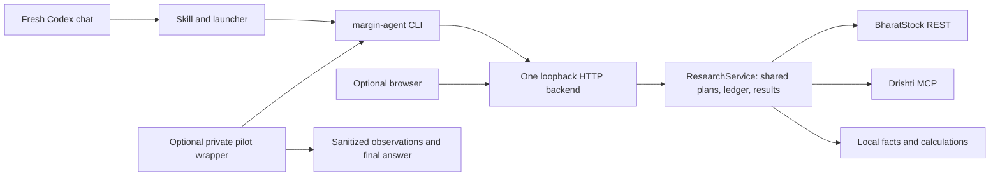

# Agent access before MCP

**0.4.0 interface note:** retained financial result JSON now includes deterministic financial_view displays. Optional shared MCP mode uses a separate explicitly started Unix-socket backend; this HTTP/CLI bridge still connects to its own existing workbench backend. Do not mix backend IDs or source handles between them. The agent skill prefers available native MCP tools and directly typed common calculations. See [MCP setup](mcp.md).

**25 November:** a separate local [MCP adapter](mcp.md) is now available without this HTTP/CLI bridge or a skill. Existing CLI/skill commands still use their configured persistent HTTP backend. Do not mix handles or reset allowances between independently running processes.

**24 November finance extension:** catalog now has 13 retrieval operations, 15 local calculations and nine company workflows. Use `finance.company_data_readiness` and `money_unit: "auto"` to inspect support. See [finance data support](design/finance-data-support.md). Old evaluation bundles remain frozen.

**24 November core 0.2.0:** ten local citation/sentiment review functions are exposed separately via `workflows`, `review` and `review-sources`. They share the same backend and existing optional --why recorder; no model inference or fetching occurs. See [review workflows](review-workflows.md). Existing retrieval/calculation catalog groups remain compatible.

Implemented **16 November 2026**. Functions are reusable Python modules in the installable `margin-research` package, available without the browser. The new `margin-agent` JSON CLI and Codex skill call the existing shared backend. Our MCP server remains unimplemented.

**Portable update:** [private test bundles](portable-agent-bundle.md) now ship the skill/runtime/setup helpers together, optionally including the user's trial keys in a separate private file. The function reference lists all 29 delivered functions. Recorded sessions now accept `note` commands for brief visible decision/observation/limitation summaries, link them to run/operation IDs and report counts at finish. These are agent self-reports, not hidden reasoning or complete host transcripts. Normal unconfigured usage still does not persist results.

## Architecture and packaging



| Component | Delivered interface |
| --- | --- |
| `margin.analysis` / `margin.finance` | Eleven explicit-input calculations, including FCFF/DCF/scenarios |
| `ResearchService` | Thirteen retrieval operations and nine company financial workflows, planning, admission, receipts and retained results |
| `margin-agent` | Synchronous local HTTP client; no provider keys, new service instances or automatic server startup |
| `skills/margin-research` | Repo-maintained skill instructions and launcher, installed separately with machine-local configuration |
| `research/pilot.py` | Optional external CLI observer; product code never imports it |

Functions belong to **one Python package**, not a distribution per function. The wheel includes the library and CLI; skill/installer and recorder are separate repo source assets. The browser is optional, but the current agent bridge needs the HTTP backend running with the `workbench` extra installed. Direct pure Python calculations do not need FastAPI:

```python
from margin.analysis.service import calculate

output = calculate("finance.calculate_dcf", explicit_model_inputs)
```

Keep composed retrieval on a persistent service. Separate CLI commands share the server's ledger and 30-minute bounded results; they never reset allowances. Restarts clear memory, not provider quota. Run submission pins the preview's backend identity. The optional pilot also rejects changed backends.

## Setup and a fresh chat

From the repository:

```sh
.venv/bin/python -m pip install -c requirements-dev.lock -e '.[workbench,dev]'
.venv/bin/python scripts/install_agent_skill.py
```

Default installation is `$CODEX_HOME/skills/margin-research` or `~/.codex/skills/margin-research`; existing destinations are refused. `connection.json` is 0600 and contains interpreter path and loopback URL only. Keep it out of Git. Moving the virtual environment requires updating/reinstalling the local copy.

On this workstation the skill is installed at `/Users/rishit/.codex/skills/margin-research`, pointing to this repo's `.venv` and `http://127.0.0.1:8765`. Recording is disabled. No backend was left running by tests.

Start one backend using the [live configuration guide](workbench.md#live-configuration-and-limits). Export provider keys in its terminal only; `.env` is not automatically loaded. A bounded example **after exporting the BharatStock key**:

```sh
MARGIN_BHARATSTOCK_REQUESTS=2 MARGIN_DRISHTI_REQUESTS=0 MARGIN_DRISHTI_CREDITS=0 \
  .venv/bin/margin-workbench --mode live --port 8765
```

Drishti needs its own reviewed allowance, enabled operations and explicit connection. Startup alone makes no provider data calls. Use `--mode synthetic` only for fictional software tests, never real-company answers. The helper cannot change modes/allowances or start/restart servers.

Open a new Codex chat in an empty workspace outside the development repo and invoke `$margin-research`. A neutral workspace is available at `/Users/rishit/Desktop/margin/agent-sandbox`. Example request:

> Use $margin-research to inspect RELIANCE's latest returned annual consolidated financials and calculate net profit margin. You may make at most one BharatStock financials request and no Drishti calls. Explain missing inputs or unknown units, and show period, basis and provenance. Do not invent data.

The skill contains capability instructions, not task-specific answers or an investigation recipe. Empty-workspace use avoids repo/history contamination, but global host tools/configuration remain. Actual fresh-model behavior and answer quality remain unmeasured; CLI tests do not establish model-host success.

## Commands

Global options precede commands. `--expect-mode live` rejects fictional mode. `--url` allows loopback HTTP origins only; redirects and proxy environment settings are disabled.

```sh
.venv/bin/margin-agent --expect-mode live status
.venv/bin/margin-agent catalog
.venv/bin/margin-agent catalog --name finance.company_margins
.venv/bin/margin-agent catalog --name finance.calculate_dcf
```

The compact catalog shows availability, held reasons and estimated costs; name filtering returns full selected schemas/defaults. Listing a schema does not establish entitlement or output accuracy. Status/catalog/source/history/result/fact reads make no provider calls. `connect-drishti` explicitly connects upstream metadata and consumes shared HTTP allowance.

`preview --file plan.json` accepts the existing `/api/plans` body, including `{"operations":[{"operation":"<name>","arguments":{}}]}` for retrieval or explicit-input calculations. `company-preview --file company.json` accepts the company planning schema:

```json
{
  "function": "finance.company_margins",
  "ticker": "RELIANCE",
  "exchange": "NSE",
  "period_type": "annual",
  "basis": "consolidated",
  "fetch_missing": true
}
```

This previews reuse or one financials dependency without fetching. Unknown units can leave the result incomplete. Supply `money_unit` only when established or intentionally declared as an assumption. See [financial contracts](financial-analysis.md).

```sh
.venv/bin/margin-agent company-preview --file company.json
.venv/bin/margin-agent run PLAN_ID --key unique-submission-001 --backend-id PREVIEW_BACKEND_ID
.venv/bin/margin-agent wait RUN_ID --seconds 20
.venv/bin/margin-agent result RUN_ID OPERATION_ID
.venv/bin/margin-agent sources
.venv/bin/margin-agent facts RUN_ID FINANCIAL_OPERATION_ID
.venv/bin/margin-agent runs
```

Use returned identifiers and inspect the preview's operations/costs. One submission uses one stable key. After an uncertain response inspect history and reconcile; do not blindly retry. `wait` polls local state for at most 60 seconds. Expired/evicted results return `result_unavailable`, never replacement data. `cancel` is not a refund. No automatic retry/fallback/page exhaustion occurs.

Output JSON includes `bridge_version`, `backend_id`, `mode`, and `data` or `error`; the action nonce is withheld. Operational errors exit 2; optional recording failure exits 3 while preserving the actual result. Exit 0 means command success, not financial validity: inspect operation/payload status and coverage. Help/usage/diagnostics use conventional CLI streams. Keys stay backend-side; the installed launcher removes provider-key variables from its child environment.

## Optional private pilot

Normal product and installed-skill calls persist no financial responses. The separate recorder stores task text, timestamped sanitized observations, backend identity and an explicitly supplied final answer. It neither calls models nor records hidden reasoning or grades answers.

```sh
.venv/bin/python research/pilot.py --session reports/private/pilot-01 init \
  --task-file /absolute/path/to/question.txt --mode live \
  --retention-until YYYY-MM-DD --allow-live-recording
.venv/bin/python research/pilot.py --session reports/private/pilot-01 call \
  --expect-mode live status
.venv/bin/python research/pilot.py --session reports/private/pilot-01 finish \
  --answer-file /absolute/path/to/final-answer.txt
```

Replace the date with an agreed retention review date. The live-recording flag is explicit scope, not proof of provider rights. No live pilot was initialized/retained during implementation. Keep sessions private/ignored and manually review/delete them; expiration blocks new work but does not erase files.

For recorded fresh-chat use, install a separate workspace copy with `scripts/install_agent_skill.py --target /absolute/workspace/.agents/skills/margin-research --session /absolute/private/session`, and check the resolved skill path in the chat. Its launcher routes calls and `finish` through the recorder. Everyday global installation stays unrecorded.

Directories are 0700, files 0600, calls serialize under a POSIX lock and logs are bounded to 50 MiB with space reserved before dispatch. Windows recorder support is untested. Successful previews preserve full backend-validated arguments; raw CLI input/rejected argument bodies are deliberately omitted to avoid credential logging. Source-bearing observations remain private.

Full host-message capture, exact request replay, frozen environments, independent filing gold, model runners, grading and study isolation remain **unimplemented**. This is a pilot tool log, not the professor's full evaluation harness. Source locators remain unverified; citation verification/sentiment protocols remain deferred.

## Verification

```sh
.venv/bin/ruff check src tests scripts research skills
.venv/bin/ruff format --check src tests scripts research skills
.venv/bin/pytest -q
.venv/bin/python scripts/smoke_agent.py --port 8794
```

The process smoke test starts/stops a fresh fictional backend and temporary installed skill/session, refuses an occupied port, strips live keys, checks shared reuse/idempotency/budgets across command processes, records a final answer and removes temporary artifacts. Zero live provider requests. See [implementation status](implementation.md) for dated live/packaging evidence.
