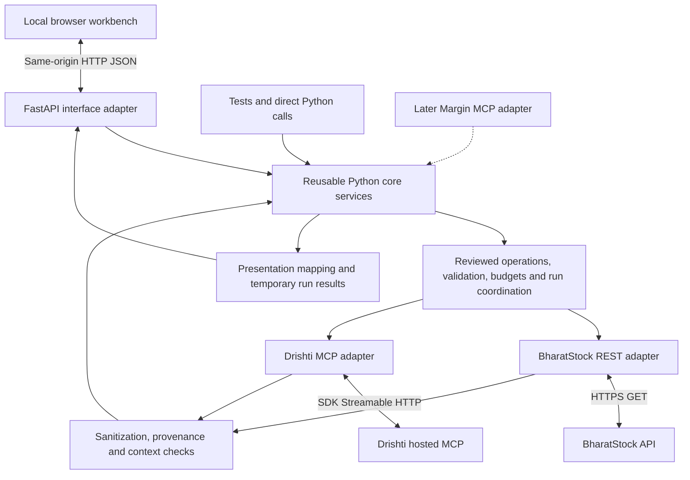

# Phase 1: core research services and local workbench

Architecture set on **20 October 2026**, implemented as the core/workbench slice, with selected live execution shown in the 21 October user export. Broader financial/source validation and Margin MCP packaging remain pending. This document describes the delivered core boundary; [delivery plan](../plan.md) owns milestones and [implementation status](../implementation.md) owns actual progress. The [MCP adapter design](mcp-aggregation.md) remains deferred.

**7 November proposed extension:** the [research-environment review](research-environment-review.md) adds opt-in permissioned capture, immutable replay, independent answer keys and an agent runner beside this live workflow. They are not implemented. In-memory/TTL/no-agent statements below describe the existing workbench; they do not prohibit the separately scoped future research mode or authorize storing provider data now.

## Goal and scope

Build the provider integration, bounded research operations and evidence handling as a reusable Python library. Exercise them through a small local browser interface before exposing our own MCP server. The provider choices remain **BharatStock REST + Drishti MCP**. Deferring Margin MCP packaging does not remove the Drishti MCP client dependency.

The temporary HTTP app is a local testing interface, not a maintained financial-data server. No financial database/corpus, crawler, vector store, LLM agent, chat UI, public hosting or account system is required. The core retrieves data on demand; the workbench displays provider results, limitations and execution evidence.

## Architecture



Use Python 3.12, async `httpx`, JSON Schema validation and the official MCP SDK for the Drishti client. SDK 2.2.0 is pinned and tested offline, not a claim about the latest release. It uses `httpx2`; the BharatStock adapter uses standard `httpx`. Exact pins and tested development constraints are in `pyproject.toml` and `requirements-dev.lock`. FastAPI/Uvicorn and a small static HTML/CSS/JavaScript interface form a replaceable development adapter. No React/Next.js project or npm build is needed initially. See the [workbench guide](../workbench.md) for installation and actual commands.

### Interface choice

| Option | Fit | Decision |
| --- | --- | --- |
| FastAPI + minimal local HTML/JS | Explicit HTTP actions, an app-owned async runtime and a clear adapter boundary | Recommended workbench |
| Streamlit | Quick data forms/tables; forms can gate execution, but reruns/session/resource lifetimes need care around async SDK sessions and shared accounting | Viable alternative, not the planned default |
| FastAPI + React/TypeScript app | Useful for a lasting product interface; adds a frontend toolchain and more integration work | Defer until the interface itself becomes a product requirement |

FastAPI documents [application lifespan](https://fastapi.tiangolo.com/advanced/events/) and [serving static files](https://fastapi.tiangolo.com/tutorial/static-files/). Streamlit documents [forms](https://docs.streamlit.io/develop/api-reference/execution-flow/st.form) for batching input changes before submission. The selection is our engineering judgment: a small request-driven UI keeps the async provider runtime explicit and the core reusable.

## Core boundaries and contracts

The core imports neither FastAPI nor UI code. Routes and browser event handlers do not call providers directly. Registry, admission, sanitization and accounting are shared by direct tests, the workbench and the later MCP adapter.

| Core component | Responsibility |
| --- | --- |
| Operation registry | Approved names, input contracts, selectors, detail modes, bounds, cost estimates and observed access states |
| Provider adapters | Direct BharatStock REST and SDK-managed Drishti discovery/execution; credential isolation and lifecycle |
| Execution policy/ledger | Atomic reservations, pacing, one active call per provider, cancellation, bounded results and uncertain outcomes |
| Operation service | Execute one reviewed operation and return a sanitized, transport-independent result record |
| Research planner/coordinator | Build an explicit bounded operation list; execute only its reviewed steps; no autonomous search/retry loop |
| Evidence services | Safe citations, receipts, reviewed-path context warnings and evidence levels |
| Presentation mapping | Tables/cards/series derived from known fields without changing provider facts or silently normalizing units |

Use a few explicit records:

- `OperationRequest`: provider/operation, explicit security or record selectors, window/cadence, page/limit, detail mode and run/request identity. No provider keys in arguments.
- `OperationResult`: status, provider/operation, sanitized provider payload, payload kind (`rest_json` or `mcp_result`), coverage/context/warnings, citations, receipt and error where applicable. The core returns data records, not MCP `CallToolResult` or HTTP response objects.
- `ResearchPlan`: immutable selected company, operation list/dependencies, windows, expected calls/credit estimates, limits and reviewed metadata/policy version. Planning is local and makes no provider calls. Unknown costs/access remain explicit and block unsupported execution.
- `ResearchRun`: plan ID, execution mode, operation states/results and shared accounting. Distinguish successful, empty, partial, blocked, failed, cancelled and uncertain results.

Preserve raw REST field names/pagination and sanitized Drishti content/structured fields inside the payload record. The future MCP adapter converts these records into the documented MCP output; it must not call the workbench HTTP server to get data.

## Feature sequence

The full reviewed provider inventory remains in the [source research](../research/mcp-provider-feasibility.md) and [Drishti reference](../reference/drishti-functions.md). Phase 1 develops vertical slices rather than exposes every function at once.

| Increment | Functionality | Test/display outcome |
| --- | --- | --- |
| 1: one operation through the core | BharatStock snapshot and one reviewed Drishti earnings-detail operation, initially synthetic | Shared validation/sanitization/receipt path works for REST and MCP |
| 2: company selection and numeric history | BharatStock search, snapshot, quarterly/annual financials, ratios, prices and corporate actions | Explicit listing/ISIN, period/basis tables, price chart and actual coverage |
| 3: news, filings and earnings | Drishti resolution/metadata, news, announcements/categories, earnings list/detail | Dated event cards, provider analysis labels, discovered record IDs and citation levels |
| 4: bounded combined run | Numeric-plus-events preset and selected earnings inspection | Independent provider sections, partial results, per-operation trace and cost estimates |
| Next extension | Concall summaries and targeted transcript search | Enable only after selected access/billing/citation tests; retain held states meanwhile |

BharatStock search/actions and most Drishti data operations remain untested live. The 9 October schema map is not permission to turn on every operation. Corporate calendars with fallback behavior, market-wide screens, ownership expansions, broad sentiment and normalized comparisons remain later work.

A minimal company-overview preset can be **snapshot + quarterly financials + news + announcements**, rather than every available module. Prices, annual financials, earnings detail and other operations are explicit additions. Do not automatically enrich every search candidate or resolve through both providers on every keystroke. Select a company first and cross-check Drishti identity only when needed. Ambiguous exchange/ISIN/scrip mappings require a visible selection; never use a global “last company”.

Earnings inspection is staged: discover a small list, choose the actual record/quarter, then explicitly fetch detail. Do not invent a quarter or silently join a newer event summary to older numeric financials. Execution can follow a small explicit dependency graph, but it cannot broaden the plan or introduce additional paid operations without a new plan.

## Temporary workbench

Use one page with four panels/tabs rather than a product dashboard:

| Area | Controls and output |
| --- | --- |
| Company and run setup | Synthetic/live mode badge; submitted search; listing selection; modules; separate dates/cadences; plan preview; Run/Cancel |
| Financials and prices | Provider values with period/basis/unit status, missing fields, coverage and simple local price chart |
| News, filings and earnings | Dated records, ingestion versus publication labels, provider sentiment/analysis labels, selected detail retrieval |
| Run inspector | Operation status, sanitized provider payload, safe citations, request/credit accounting, durations, failures and warnings |

Every view shows provider, retrieval/as-of time where known, mode and evidence status. An unavailable section stays unavailable; it is not replaced with synthetic data in a live run. A known conflict such as the tested revenue discrepancy stays visible. The payload viewer is **sanitized provider JSON**, not unsanitized raw output. Insert provider text as escaped text, not executable HTML.

Presentation is deliberately modest: tables and a price line generated locally with native SVG/Canvas are sufficient. Do not add UI polish, external chart services, chat answers, model subscriptions or speculative analytics before testing the data. Formatting is not verification: never label an unknown scale as rupees/crores, replace null with zero or convert by field name alone. Source-defined unit mappings need their own evidence and tests.

Citation creation and verification stay separate. Show safe public links where actually supplied, and a record/locator with “requires authorized resolution” when API auth is needed. Do not expose key-bearing or signed private links to the browser. Original-document retrieval and claim/page verification remain a separately tested later component.

### Implemented local HTTP surface

These are internal workbench endpoints, distinct from provider routes:

| Route | Purpose / provider effect |
| --- | --- |
| `GET /api/status` | Cached configuration, connection/evidence states, local allowances and execution mode; no provider request |
| `GET /api/capabilities` | Reviewed operation schemas, enabled/held states and limits; local only |
| `POST /api/provider-connections/drishti` | Explicit bounded connect/selected metadata refresh; counts lifecycle/discovery traffic |
| `POST /api/plans` | Validate/build an immutable operation plan, including a submitted company search; no live lookup |
| `POST /api/runs` | Start a selected plan with an idempotency key; the only normal data-execution entry point |
| `GET /api/runs/{run_id}` | Local progress/summary/receipts; no provider fetch |
| `GET /api/runs/{run_id}/operations/{operation_id}` | One retained sanitized result; no provider fetch |
| `POST /api/runs/{run_id}/cancel` | Stop queued/dependent work and propagate supported cancellation; no assumed refund |

The UI can wrap plans/runs behind Search and Fetch buttons; users do not need to manipulate IDs. Searching is itself a budgeted operation, not a live side effect of creating a plan. Begin with polling local run state; no WebSocket/SSE or distributed job queue is needed. A bounded in-process task coordinator is sufficient.

## Lifecycle, mode and spending controls

- Default to **synthetic mode** with clearly labelled fictional companies/values and no external/provider network; do not copy licensed real payloads into those fixtures. Live mode requires explicit local configuration; never mix live and synthetic provider results in a run. Do not infer entitlement from the presence of a key.
- Bind the workbench to `127.0.0.1`, use one worker and one app-owned async runtime. Keep keys in the backend environment; no key fields in the browser. Same-origin routes, validated host/origin and a local action nonce protect state-changing actions; no wildcard CORS or public deployment is planned.
- FastAPI lifespan creates runtime state, HTTP clients, ledger and task owners; startup/page rendering performs **no provider data call**. Drishti connection/discovery is an explicit budgeted action. If reviewed metadata is expired/changed or a live connection is unavailable, block with an actionable refresh/connect state; GET/planning never refreshes upstream metadata implicitly. SDK-implicit discovery within an authorized action is still counted. A dedicated serialized adapter task owns SDK context entry/exit so browser requests/rerenders do not create a new async session or close a context in another task.
- Keep one active call per provider and independent failure handling. The two providers may progress independently when the plan permits. Use the existing argument/response/window limits, including price versus narrative-list bounds and 365-day earnings discovery. No automatic retry, pagination, full-transcript fetch or generic-URL downloading.
- A double-click/repeated POST with the same idempotency key and identical plan returns the existing run; the same key with another plan is rejected. Record intent before dispatch. Browser reload/tab changes only reread local state, never replenish allowances or repeat a call.
- Cancellation stops work not yet dispatched. A timeout/disconnect can leave remote spend uncertain; retain the reservation and do not replay it automatically. Reconcile before dependent execution. One failed provider can yield a visibly partial run.
- Budgets belong to the backend process/credential context and are shared across tabs/runs. Process restart loses in-memory accounting; live auto-reload and multiple workers are disabled. Counters are not a durable account-wide daily cap or proof of credits used by other clients.
- Keep only bounded in-memory sanitized run results needed for inspection: maximum five retained runs, 20 MiB total payloads and 30-minute TTL. Reserve result headroom before dispatch and evict only eligible completed payloads. Keep lightweight idempotency/accounting records separately so payload eviction never permits a duplicate paid execution; reject new work when their safe bounded capacity is reached. Expired results return unavailable, not an automatic refetch.
- Clear buffers on shutdown. No raw-response export, persisted replay library or financial response cache is enabled by default. Commit synthetic/minimized fixtures only. Temporary permitted evaluation receipts remain ignored/private with explicit expiry; they are not a maintained corpus.

The last observed Drishti balance is **986 on 9 October**, not a fresh balance or entitlement check. Existing prospective diagnostic ceilings are reference plans, not standing authorization to make calls today. Reconcile current access/allowance and write an ordered run budget before a future live pass. The 8/9 October private outputs have manual review dates 22/23 October; do not silently extend their retention or use them as committed fixtures.

## Validation and phase exit

1. **Core tests:** REST mapping/header/pagination; selected nested schema plus logical bounds; value/period/basis preservation; unsafe metadata/text/JSON/error sanitization; no implicit conversions; empty/partial/uncertain results.
2. **Adapter tests:** synthetic REST and synthetic Drishti MCP upstreams through real clients; SDK context/task ownership, lifecycle accounting, schema drift, timeout/cancellation, cleanup and independent failure. No downstream Margin MCP server is needed for these tests.
3. **HTTP/UI tests:** synthetic app startup without external/provider network; correct payload/view rendering; escaped text; no leaked keys/URLs; no live fetch on GET/rerender; duplicate Run has one dispatch; refresh shares the ledger; cancelled/expired/partial states remain explicit.
4. **Bounded live validation:** RELIANCE first, then TCS only if the first results and allowance justify it. Reuse documented knowledge rather than repeat full tests. Compare a small set of financial cells/events with original evidence where obtainable. Runtime success is not financial verification.
5. **Manual workbench demo:** select a company, inspect numeric and event results, pick earnings detail, inspect provenance/conflict warnings, and see a partial/failed case. Record actual calls/credits, latency, missing coverage and independently checked cells.

Phase 1 exits when the same tested services work directly and through the workbench, selected real REST/MCP paths are demonstrated, duplicate UI actions cannot silently multiply calls, known source limitations are visible and setup/run instructions work on a clean environment. An MCP-host/LLM evaluation is a later phase; no model-accuracy gain is claimed from the manual demo.

## Later MCP adapter

After the core/workbench gates pass, add `interfaces/mcp/` to list reviewed tools and convert core results to MCP content/structured output/errors. It calls the same service methods and shares the same admission/ledger/evidence path. The browser UI remains useful for debugging and need not be part of the MCP install. Then add downstream stdio tests and paired real-host evaluation. This sequencing changes packaging, not providers or evidence standards.

Implemented layout (the later MCP directory is not created):

```text
src/margin/
  core/                  contracts, registry, operations, planner and run coordinator
  providers/             BharatStock REST and Drishti MCP adapters
  policy/                validation, budgets, pacing, bounds and lifecycle rules
  evidence/              sanitization, context, citations and receipts
  interfaces/
    workbench/           FastAPI routes, app lifespan, view mapping, static UI
    mcp/                 later; not created during initial core implementation
tests/                   synthetic core/provider/HTTP/UI tests and opt-in live checks
docs/                    current design, evidence, setup and status
```

The first implementation includes `pyproject.toml`, tested development dependency constraints, Ruff/pytest and a default test suite blocking real sockets. Workbench dependencies are optional. The [implementation checkpoint](../implementation.md#first-coreworkbench-build-checkpoint) owns actual verification.

Initial implementation limits: operations within each run execute sequentially, while separate runs can progress independently across provider locks. Plans contain explicit operations rather than an autonomous dependency graph. Output rendering recognizes reviewed paths; unknown layouts remain inspectable sanitized JSON. Live-held operations require explicit configuration in addition to schema refresh, and account balances/actual credit debits are not automatically queried. The result buffer is temporary diagnostic state, with no filesystem response cache. Synthetic scenario coverage and offline client tests do not prove current live entitlements, output shapes or financial accuracy.
