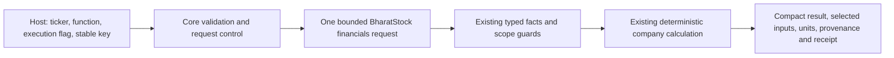

# Self-contained company finance

Planned 25 November 2026, after the 0.4.0 LM Studio retest. This document owns the
fresh-fetch workflow; [MCP usage](../mcp.md) owns installation and examples. User
authorization supersedes the earlier requirement that every company request must
depend on retained results or a separately submitted plan. Preserve the old interfaces.

## Problem and intended behavior

The host reconstructed facts and lost row provenance in the HINDUNILVR retest. The
retained-facts operator check succeeded without another provider request. Context
exhaustion is possible but unproven; tool execution and final prose accuracy are
separate outcomes. Avoid asking small models to transport financial records at all.

Add `margin_company_finance`: ticker and one of the nine existing company functions
in, bounded API fetch and deterministic answer out. A new executed request always
fetches fresh financials, even if earlier raw results exist. No prior source handle,
database, model inference, automatic discovery or Drishti connection is required.
Raw provider data exists only while that request is running; it is not placed in the
retained source buffers. Existing retrieval/review workflows keep their temporary
buffers and are not removed by this change.

## Contract and execution

- One typed MCP tool, backed by a reusable core workflow, not provider code in the
  MCP handler. Inputs: function, ticker; exchange defaults NSE, basis consolidated,
  metric revenue, period type annual (quarterly for TTM). Only reviewed enums.
- `execute: false` is a local preview, the default: show exact endpoint/arguments,
  one maximum BharatStock request, zero estimated Drishti credits, and limitations.
  It creates no provider work or run/plan records.
- `execute: true` explicitly requests the previewed kind of bounded work in one tool
  call. A stable `idempotency_key` is required; a separate plan/session handoff is not.
  This is the authorized convenience path. Legacy preview/run remains unchanged.
- Use `GET /v1/stocks/{ticker}/financials`, `exchange`, `period_type`, page 1 only.
  Request 4 rows for latest-period groups, 8 for growth/CAGR and 16 for TTM. These
  allow both reporting bases but cannot guarantee enough usable rows. No second
  page, hidden retry, alternate provider or unit/date inference. Basis is checked
  locally because the current reviewed adapter does not send a basis filter.
- Supported: data readiness, margins, profitability, cash conversion, cash-flow
  metrics, balance-sheet metrics, growth, CAGR and TTM. Reuse the existing math and
  continuing-profit selection. Missing fields, incompatible scopes, ambiguous rows
  and unsupported periods stay incomplete/partial. More requests cannot manufacture
  missing issuer data. DCF/FCFF/valuation assumptions remain explicit-input tools.
- Return status, exact values/formula, component holds, short selected-input records
  with definitions/units/periods/source paths, coverage, accounting and source caveat.
  No full provider payload or duplicated full fact objects in this response. Bound
  the compact response to 32 KiB; keep meaningful holds instead of inventing values.
- Keep at most `max_records` request controls, capped at 200, in process memory.
  Store only fingerprint, task and completed compact response; no raw response.
  Same key/same normalized financial inputs joins or reads that request; conflicting
  inputs are rejected. Keys are not silently expired/reused. At capacity, block new
  requests. This is bounded duplicate protection, not a financial repository.
- A disconnected/cancelled waiter must not start a duplicate or cancel an already
  dispatched request. A subsequent identical call may safely join the existing task.
  Provider uncertainty, quota and timeout guards remain in the existing executor.
  Explicit backend shutdown cancels active work and preserves uncertain accounting
  until shutdown. Restart loses keys and local counters: no cross-restart exactly-once
  promise, no automatic recovery/retry. A future multi-worker hosted deployment needs
  a deliberate shared request/quota control solution, independently of financial storage.

## Subscriptions and live testing

Public sources inspected 25 November 2026:
[BharatStock pricing/FAQ](https://bharatstockapi.com/) and
[terms](https://bharatstockapi.com/terms).

- Public Free listing: 60 requests/day, one year history. Existing trial was supplied
  as 25/day; published quota changes do not prove this key's entitlement.
- Starter: INR 500/month before tax, 1,000 requests/day and full history. This is a
  technical history/volume option, not the model-evaluation recommendation.
- Developer: INR 1,500/month before tax, 8,000 requests/day; public FAQ includes
  personal/internal model evaluation and backtesting on Developer/Business/Pro,
  excludes Free/Starter. Recommend Developer before further model-evaluation live
  runs unless the account has an applicable separate agreement. Margin uses REST;
  buying access to BharatStock's native MCP is not the architectural reason.
- No Drishti subscription is needed for these numerical finance workflows. Its
  event/news workflows and applicable rights remain separate.
- Local software validation needs no purchase. Do not make new authenticated
  provider/model calls in this build or restart the existing live backend to reset
  its exhausted local BharatStock allowance. A later live acceptance plan is one
  margins request plus, if authorized/history permits, one growth request; log real
  attempts and preserve provider-unverified labels. No purchase/contact is authorized.

## Build and acceptance

1. Publish this plan before runtime changes. Add the core fresh-request coordinator
   and compact financial response, then one MCP tool and route guidance; retain all
   existing pure calculations and legacy company reuse behavior.
2. Test with labelled fictional transports: all nine functions, no buffer dependency,
   forced freshness despite existing sources, one request, zero Drishti, no-call
   preview/invalid input, scope/unit/duration guards, empty/missing basis, quota/401/
   429/timeout, key conflict/duplicate/concurrency, waiter cancellation, capacity,
   response size, shutdown and recording. Check source paths/units against known
   saved real HUL response offline, without new data calls; this is not model success.
3. Run full offline suite, lint/format, official-SDK standalone/shared fictional
   acceptance, build/inspect wheel and test installed entrypoint. Document evidence
   separately from unperformed live/provider and model-host acceptance.
4. Update MCP/core architecture, implementation/context/handoff, function map and
   source skill/reference. Preserve historical packages and private evaluation gold.
   Do not replace/restart the running live installation or reset budgets silently.
