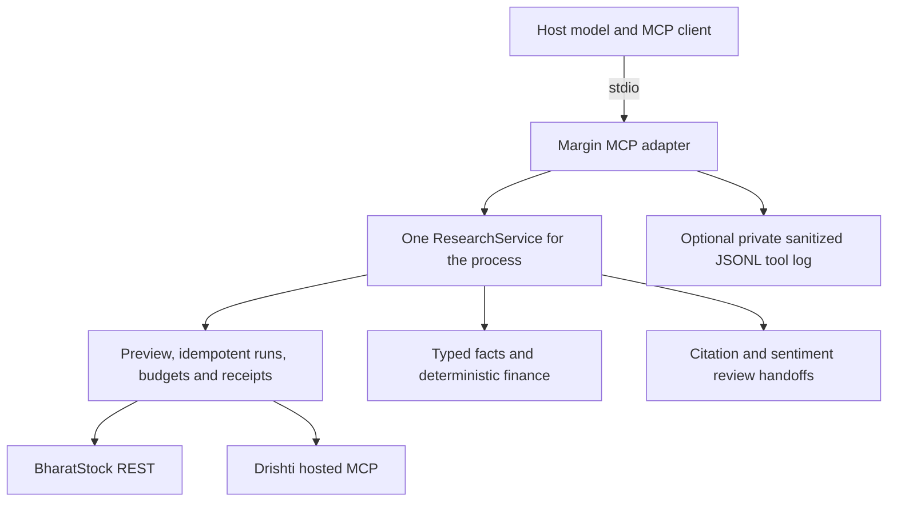

# Margin MCP adapter architecture and implementation plan

Planned and implemented **25 November 2026**, after core checkpoint `6b22f57` was pushed and validated
with 194 tests. The implementation plan was pushed as `07b981a` before runtime work. The tested alpha is package 0.3.0 with 14 tools, 220 offline tests and source/isolated-wheel SDK stdio acceptance. [MCP usage](../mcp.md) owns commands and host configuration. This replaces the historical
proposal; its earlier text remains in Git history. [Core architecture](core-workbench.md),
[finance contracts](../financial-analysis.md), [review workflows](../review-workflows.md)
and [finance support](finance-data-support.md) remain authoritative for underlying behavior.

## Scope and architecture

Build a Python **local stdio MCP server** over the installed official SDK `mcp==2.2.0`.
The existing REST and upstream Drishti MCP adapters remain. No extra web backend, npm
package, database, Margin-side LLM, sampling fallback or public HTTP service is required.
The workbench and agent CLI remain available separately; each independently launched
backend has its own counters, not a shared account-wide allowance.

The transport adapter calls public core methods, not HTTP routes or private run buffers.
Expose a stable workflow surface rather than 47 largely overlapping flat tools. All
13 retrieval, 15 local finance/fact and nine company operations remain discoverable;
ten review functions are separately discoverable in the same catalog. Nested names
must match those reviewed allowlists. Never expose Drishti's generic native executor.

## Public tool surface

| MCP tool | Core behavior | Provider calls |
| --- | --- | --- |
| `margin_status` | Mode, process ID, provider readiness and ledger | none |
| `margin_catalog` | Summary or filtered exact schemas for retrieval/calculation/company/review | none |
| `margin_preview` | Preview one to eight approved retrieval/local-calculation operations | none |
| `margin_company_preview` | Resolve retained financials versus one explicitly allowed dependency | none |
| `margin_run` | Submit existing plan with process ID and idempotency key; optional bounded wait | only planned operations |
| `margin_run_status` | Inspect a run, optionally wait at most 30 seconds | no new operations |
| `margin_result` | Retrieve one retained sanitized result | none; never refetch |
| `margin_sources` | Available retained financial responses | none |
| `margin_facts` | Typed facts with `auto`, explicit scale or unknown policy | none |
| `margin_calculate` | One of 15 explicit-input calculations directly | none |
| `margin_cancel` | Explicitly cancel a run, preserving uncertain-dispatch accounting | no retry |
| `margin_connect_drishti` | Explicit upstream metadata lifecycle action, guarded by process ID | bounded metadata HTTP |
| `margin_review` | One of ten local citation/sentiment functions | none/model-free |
| `margin_review_sources` | Import retained source text into the review store | none |

Catalog summaries omit bulky schemas by default. Exact schemas are requested by name
and group. Preview operations still receive strict core validation, holds, bounds and
cost estimates. Company functions retain the existing `fetch_missing: false` default.
Independent calculations and review actions do not require a preview since they cannot
fetch data. Partial/incomplete financial results are valid domain outcomes, not invented
values or transport failures. Pure calculations have no hidden source lookup.

## Lifecycle and contracts

- Create one core service in MCP lifespan; close all tasks/providers on EOF/shutdown.
  Tool listing, initialization and status must not connect to providers.
- Generate an opaque process/session ID and a per-call ID for log correlation. Preview returns it; run and Drishti connection
  require it. A restarted process rejects old handles before paid dispatch.
- Preserve core plan expiration, idempotency keys, shared concurrency/allowances and
  Drishti metadata checks. Run/status waiting is bounded to 30 seconds and shielded;
  cancelling a tool-call waiter does not silently replay/cancel an already submitted run.
  Use `margin_cancel` for explicit run cancellation. Retry submission only with the same
  plan/key; uncertain upstream outcomes are not automatically retried.
- Return both structured JSON and JSON text for older clients. The envelope contains
  adapter contract version, process/call IDs, mode, tool and data or safe error. Financial
  definitions, units, source paths, unverified labels, receipts and limits stay intact.
- Validate tool schemas and 64-KiB input bounds before dispatch. Reject unknown keys,
  nonfinite numbers, arbitrary operation names and credential-bearing arguments.
  Sanitize errors and bound output; never print secrets, raw exceptions or HTTP headers.
- Protocol messages alone use stdout; diagnostics use stderr. No real keys in config
  examples, tool arguments, source, Git, skills or bundled wheel metadata.
- Optional `why` is one visible line (1–280 chars), an agent self-report rather than
  hidden reasoning. Optional operator-configured JSONL recording stores sanitized
  request/result events. Logging is off by default, private 0600, and outside product
  imports of the research harness. Pre-dispatch write failure stops execution; a
  post-dispatch failure returns the available result with an explicit warning.
- Annotate read-only/idempotent/local versus provider actions accurately. Annotations
  are advisory and do not replace admission/validation. Tool names/schemas are stable;
  current provider availability comes from status/catalog rather than dynamic removal.

## Implementation sequence

1. **Push current core**: source/private-data/secret review, regression suite, commit/push
   checkpoint. Completed: `6b22f57`, no private captures or numerical gold included.
2. **Plan before code**: publish this architecture, mapping and acceptance checklist;
   update AGENTS/context to replace the old no-MCP gate. No runtime changes in this step.
3. **Thin adapter**: `src/margin/interfaces/mcp/{server,tools,recording}.py`, module launcher
   and `margin-mcp` entry point. Explicit `--mode`, optional local credential file and
   optional recording path; normal provider configuration continues through environment.
4. **Tests**: direct handler contract/guard tests, SDK client over real stdio subprocess,
   complete fictional retrieval/finance/review workflows, restart/idempotency/cancellation,
   logging, output redaction and shutdown. Existing core/CLI/workbench tests must pass.
5. **Package and document**: build/install the wheel in a separate target, exercise its
   stdio launcher, provide host-neutral configuration and a fresh-chat starter. Host
   inference/benchmark runs remain a separately labelled next gate.
6. **Push adapter**: final source/artifact scan, commit and push the tested alpha. Retain
   diagnostics privately; do not rebuild old 16-November evaluation archives.

## Acceptance gates

| Gate | Required observation |
| --- | --- |
| Protocol | SDK initialize, stable 14-tool list, valid tool schemas/results, text and structured output, clean stdout/EOF |
| Full reachability | Catalog accounts for all 37 retrieval/finance and ten review functions; exact schemas discoverable |
| Cost/state | No startup/list/status/preview/fact/review fetch; repeated run key dispatches once; stale process rejected |
| Domain limits | Unknown/missing/held inputs remain explicit; scope/unit/TTM safeguards survive transport |
| Lifecycle | Explicit cancellation and shutdown drain tasks and close upstream sessions; no automatic retry |
| Logs | Why is optional/validated; logs off by default; configured logs are sanitized, private, ordered and bounded |
| Packaging | Wheel includes adapter/entry point, excludes credentials/research answers/private results; isolated launch works |
| Host | Actual MCP SDK transport exercised; model-host decision quality is not inferred from protocol tests |

First implementation validation uses fictional software fixtures, clearly labelled,
with **zero authenticated provider/model API requests**. The earlier real core results
are evidence for provider behavior, not a new MCP-host test. Any later real MCP probe
needs its own bounded budget; paid plans are not a prerequisite for packaging.

Reference baseline: [MCP tools specification](https://modelcontextprotocol.io/specification/2025-11-25/server/tools)
and [official Python SDK](https://py.sdk.modelcontextprotocol.io/). The installed pinned
SDK's constructor callbacks/lifespan/stdio APIs were inspected locally; do not copy v1
decorator examples or silently upgrade dependencies for this adapter.

## Alpha implementation result: 25 November

The source adapter and isolated wheel each completed 27 actual stdio SDK calls across
all 14 tools, with 54 private sanitized log events and matching text/structured results.
Protocol negotiation was 2025-11-25. The catalog exposed 13/15/9/10 operations by group.
Provider/model calls were zero: the acceptance companies and annotations are fictional
software fixtures. Core financial/data guards remain covered separately, including
previous real-source tests. Additional lifecycle/invalid-input/logging tests bring the
suite to 220. Per-call IDs were added to the planned envelope for explicit log correlation.

An isolated target import and console-script launch passed using existing pinned
dependencies. Clean dependency installation on other platforms, real-model host behavior
and a newly budgeted live MCP pass remain unverified. No host settings were changed.
The wheel and source scans exclude credentials, private answers and provider captures.

## Distribution and live-release evaluation: 25 November

This section is researched planning, not a new release, hosting deployment or conformance
claim. Public standards and provider terms were checked on 25 November 2026. The current
0.3.0 alpha remains a local stdio application with 2025-11-25 transport acceptance.

### Recommended distribution

Release the local Python application first, using separately supplied provider credentials.
Publish a tagged, scanned wheel and source distribution through GitHub Releases, then
PyPI after clean installation and host acceptance. Users install the application and
configure a stdio-capable host to launch `margin-mcp`. No Margin-operated financial data
server, mandatory skill, npm rewrite, or public service is needed for that release.

| Form | What users receive | Evaluation for Margin |
| --- | --- | --- |
| Python wheel / source distribution | Installable application, dependency metadata and console launcher | Primary distribution; already has a wheel, release pipeline still needed |
| MCPB desktop bundle | ZIP-based `.mcpb` plus `manifest.json`, runtime/dependency setup and configuration | Optional later convenience for supporting desktop hosts; test Python/platform support |
| OCI/container image | Reproducible runtime launching stdio or a separately implemented HTTP adapter | Optional deployment artifact; containerization alone adds no remote MCP endpoint |
| Hosted Streamable HTTP | An HTTPS URL configured in a compatible host | Later service offering; requires authenticated user isolation and operational controls |
| MCP Registry entry | Versioned discovery metadata pointing to a package or remote endpoint | Optional discoverability step; does not deploy or host Margin |

MCPB is a desktop distribution format, not a prerequisite for MCP interoperability. Its
manifest supports Python servers and sensitive user configuration. Bundled dependency and
Python availability still need platform validation. See the [MCPB specification](https://github.com/modelcontextprotocol/mcpb/blob/main/MANIFEST.md).
The [Python publishing guide](https://packaging.python.org/en/latest/guides/publishing-package-distribution-releases-using-github-actions-ci-cd-workflows/)
describes tagged wheel/source releases and PyPI Trusted Publishing without a long-lived
publishing token. No package-name availability, PyPI ownership or registry namespace has
been established for Margin.

### Standards and measured gaps

The current dated MCP specification is **2026-07-28**. It uses `server/discover` and
per-request metadata rather than the older initialization handshake. Inspection of the
installed Python SDK 2.2.0 found modern and legacy implementation paths; our tests use
`ClientSession.initialize()` and demonstrate only the legacy negotiated version. Test
both eras before advertising compatibility; do not upgrade dependencies blindly or
assume every host supports the same revision. [Specification](https://modelcontextprotocol.io/specification/2026-07-28),
[SDK version negotiation](https://py.sdk.modelcontextprotocol.io/protocol-versions/).

| Requirement or practice | Margin assessment / action |
| --- | --- |
| JSON-RPC framing, tool discovery, valid declared capabilities and revision behavior | Legacy stdio exercised; add modern discovery/request-envelope coverage and publish a compatibility matrix |
| Protocol-only stdout; diagnostics on stderr | Implemented and transport-tested |
| Input validation and structured output conforming to advertised schemas | Implemented at envelope/core level; schemas for nested results remain broad and should become more informative |
| Protocol versus tool execution errors | Unknown tool names now return JSON-RPC errors in patch 0.3.1, tested over stdio; provider/business failures remain tool errors |
| Cancellation, expired handles, no duplicate paid dispatch | Existing tests cover key cases; repeat across supported protocol eras and actual hosts |
| Tools versus optional resources, prompts and extensions | A tools-only server is valid; none of the optional features is mandatory for our release |
| Python package release metadata and provenance | Add chosen code license, project URLs, support/changelog and release automation; confirm dependency license/security compatibility |
| Honest product semantics | Preserve missing-data/unit/scope caveats and host-reported citation/sentiment labels; packaging does not authenticate original sources |

The [tools specification](https://modelcontextprotocol.io/specification/2026-07-28/server/tools)
distinguishes unknown-tool/malformed-request protocol errors from actionable execution
errors. An advertised output schema must match structured results. Richer per-tool output
schemas and simpler high-frequency financial tools are usability improvements, not a
requirement to flatten all 47 nested functions. Test small-model discovery first.
The [stdio binding](https://modelcontextprotocol.io/specification/2026-07-28/basic/transports/stdio)
requires clean newline-delimited JSON-RPC on stdout.

### Release sequence and acceptance

1. **Standards repair:** correct protocol error mapping; exercise modern and legacy
   discovery/list/call/cancel/shutdown and malformed-input wire behavior. Record supported
   revisions and exact SDK/test-tool versions. Keep initial tests offline.
2. **Releasable artifact:** choose the code license with the project owners; complete
   metadata/changelog, build wheel and source distribution, scan both for credentials,
   provider captures, private logs and evaluator answers. Install from the artifacts on
   clean macOS/Linux/Windows environments with supported Python versions. Existing
   isolated-target acceptance reused dependencies and does not satisfy this gate.
3. **Independent clients and real data:** test with MCP Inspector, then at least two
   actual target hosts. Use a separately recorded one-company live plan and explicit
   provider HTTP/credit bounds. Verify source units, financial results and data reuse,
   quota/access failures, cancellation and duplicate submission behavior. Never charge
   production credentials during broad conformance/fault scenarios.
4. **Private beta and evaluation:** distribute the versioned artifact to the team;
   collect setup failures and workflow traces. Compare catalog-based versus simpler
   discovery if smaller models struggle. Run matched with/without-Margin tasks with
   independent answers; log tool inputs/outputs and visible one-line self-reports,
   not hidden reasoning. The optional professor harness remains separate.
5. **Public local release:** after the gates, tag and publish artifacts, verify a fresh
   installation, then publish registry metadata if desired. Hosted deployment follows
   its own gates below; public software distribution and data-serving rights differ.

[MCP Inspector](https://modelcontextprotocol.io/docs/tools/inspector) provides interactive
and CLI clients. The [official conformance framework](https://github.com/modelcontextprotocol/conformance)
provides revision-filtered wire/schema checks; select applicable tools-only scenarios.
Its documented server target is an HTTP URL, so do not assume its full server suite can
run against our current stdio launcher unchanged. Inspector and our SDK subprocess tests
can cover stdio while HTTP-specific conformance follows the HTTP adapter.

### Hosted service: separate architecture gate

Use a new Streamable HTTP adapter over the same core, exposed behind TLS at an endpoint
such as `https://<chosen-domain>/mcp`. The modern revision accepts POST and removes the
standalone GET stream and protocol sessions. Legacy-compatible serving must retain the
older revision's behavior when that revision is negotiated. Do not copy an old SSE-only
deployment recipe. The SDK should implement wire behavior; validate it at the deployed
proxy as well. [HTTP transport specification](https://modelcontextprotocol.io/specification/2026-07-28/basic/transports/streamable-http).

For a restricted service that spends provider credits, implement interoperable OAuth
authorization, protected-resource discovery and token audience/issuer/expiry/scope checks.
Authorization is optional in MCP generally; it is our service requirement, not a universal
condition for a local server. Stdio instead takes operator credentials locally.
Authenticate users independently of provider keys and opaque run handles. Never forward
a Margin access token upstream as a provider credential.
[Authorization specification](https://modelcontextprotocol.io/specification/2026-07-28/basic/authorization).

Before exposing the endpoint, add:

- Identity-scoped core/run/review state and authorization on every handle lookup; never
  share today's one process-wide service and result buffers across arbitrary users.
- Atomic provider-account and user allowances across processes/restarts, plus bounded
  concurrency and idempotency. A small operational ledger/store is not a financial corpus.
- Explicit provider-key ownership model: user credentials stored as protected secrets,
  or Margin-owned subscriptions with applicable end-user/re-exposure rights. Local BYOK
  reduces shared-secret hosting work but does not waive provider restrictions.
- Host/Origin allowlists, applicable CORS, request/time/output bounds, abuse protection,
  sanitized metrics, opt-in private recording, retention/deletion, health/readiness checks
  and controlled shutdown/rollback. Treat provider narratives as untrusted source text.
- Tenant-isolation, wrong-audience, expired-token, quota-race, restart, proxy-streaming and
  sustained-load tests using fictional upstreams before a bounded real acceptance pass.

Modern MCP transport statelessness does not remove application state: our retained plans,
results, review packets and cost accounting still need ownership, TTL and routing/storage.
Start with a controlled single instance or explicit workspace routing; add workers only
after state and ledger behavior are defined. See [SDK deployment guidance](https://py.sdk.modelcontextprotocol.io/run/deploy/)
and [MCP security guidance](https://modelcontextprotocol.io/docs/2026-07-28/tutorials/security/security_best_practices).

### Registry and provider permissions

The official registry accepts local-package or remote metadata through `server.json` and
`mcp-publisher`. A candidate GitHub namespace is `io.github.rishitttt/margin`, subject to
ownership authentication and availability. PyPI entries require the package README's
`mcp-name:` marker to match the registry server name. Registry schema versions are
independent of MCP wire revisions; generate against the publishing schema current at
release time. Registration is optional for using a configured server and is not evidence
of financial accuracy or host compatibility. [Publishing guide](https://github.com/modelcontextprotocol/registry/blob/main/docs/modelcontextprotocol-io/quickstart.mdx),
[package ownership requirements](https://github.com/modelcontextprotocol/registry/blob/main/docs/modelcontextprotocol-io/package-types.mdx).

Published provider terms distinguish ordinary querying, internal model evaluation and
third-party serving. BharatStock lists internal model evaluation on Developer/Pro and
separate conditions for distributed/productized uses. Drishti distinguishes internal
use, permitted display/programmatic re-exposure and redistribution; its platform/order
agreement may govern. Confirm the actual agreements for our benchmark and any hosted
aggregation before promising those uses. This public-page review does not establish our
account permissions. No plan purchase or provider contact was made.
[BharatStock terms](https://bharatstockapi.com/terms),
[Drishti terms](https://drishti.manasija.in/legal/terms-and-conditions).

## Implementation plan: financial fidelity and reconnects, 25 November

Authorized after the live HINDUNILVR review. Preserve the raw payload, financial guards,
existing 14 workflow tools and historical evaluation archives. Initial implementation
and saved-response checks make zero authenticated provider/model calls.

1. Add a shared deterministic financial view to retained financial results: reviewed
   statement INR versus EPS INR/share, exact crore conversion, stable metric labels,
   period/basis/source paths, missing values and continuing/total-profit warnings. Never
   infer a unit from magnitude, rename operating profit as PBT/EBIT or authenticate a
   provider record by formatting it. Bound the view and retain raw data unchanged.
2. Add six directly typed MCP tools for margins, unit conversion, period comparison,
   cashflow metrics, profitability and balance-sheet metrics. Copy actual core schemas;
   remove the function-selector/nested-arguments step for these tools. Keep generic
   calculation/catalog access, exact validation and explicit input provenance. Measure
   discovery schema size; this is not a decision to inline all review/provider schemas.
3. Add optional local shared-backend mode: an explicitly started `margin-backend`
   process owns one ResearchService, stable process ID, quotas, idempotency and TTL-bound
   buffers. Short-lived stdio frontends connect over a private filesystem Unix socket.
   Use no HTTP dependency/public listener, maintained corpus, automatic provider call or
   automatic allowance reset. The backend owns credentials and optional sanitized logs;
   proxy processes never receive keys. Socket-directory/socket permissions, framing and
   request/output bounds, single-backend ownership and fail-closed version/epoch checks
   are required. Do not retry an ambiguous local RPC. A backend restart still invalidates
   handles and counters; filesystem persistence of licensed data/account-wide spending
   is outside this change. Shared mode initially targets macOS/Linux; standalone stdio
   remains available. No silent worker autostart/restart after a failure.
4. Test exact schemas and financial guards; real SDK stdio; two successive frontends
   using one backend for preview/submit/result/facts, source reuse and unchanged quota;
   idempotent duplicate submission; backend restart/stale IDs; malformed framing,
   unavailable backend, private logs and shutdown. Reprocess the saved real HUL response
   separately from fictional regression data. No new paid request is necessary.
5. Build and scan a new wheel, validate installed-package shared mode outside checkout,
   update source/installed skill deliberately, docs and private evidence, push the
   implementation. Start/configure the local mtest backend only with a zero-provider
   startup and preserved credential/allowance settings; host/model acceptance is then
   a distinct user retest. Keep the professor's evaluator independent.

The backend is an application-state owner, not protocol-level MCP sessions or a public
multi-user service. Do not weaken `session_changed` or bypass the preview/run boundary to
work around LM Studio lifecycle behavior. This plan supersedes the earlier no-extra-
backend assumption only for the explicitly requested optional local shared mode.
