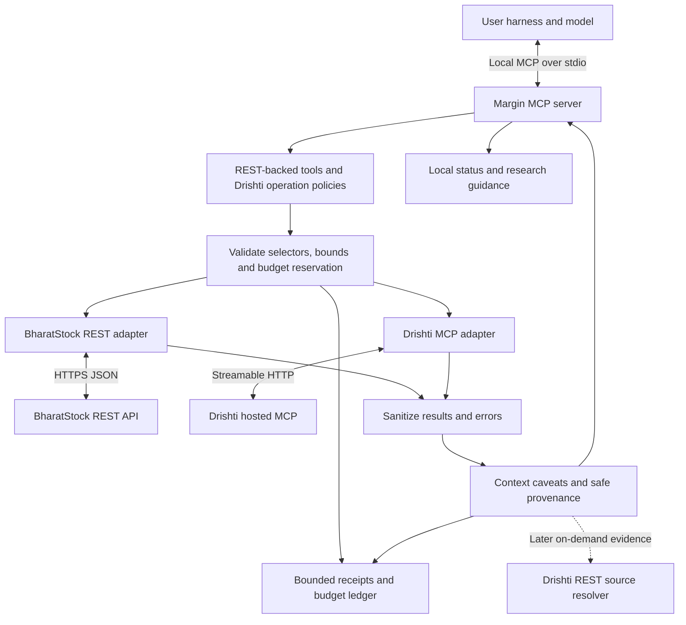

# Later MCP interface adapter (deferred)

**20 October 2026 scope update:** Phase 1 now builds reusable Python core services and a temporary local workbench. The [core/workbench architecture](core-workbench.md) is the active implementation design; [delivery plan](../plan.md) owns sequencing. This document preserves the **9 October downstream MCP design for a later phase**, not an instruction to package a Margin MCP server first. Its “first release” references below mean the later MCP release. Shared provider/admission/evidence principles remain relevant, but current lifecycle/result/UI contracts come from the core design.

No core, UI or Margin MCP server is implemented. The [25-function reference](../reference/drishti-functions.md) and [provider research](../research/mcp-provider-feasibility.md) own source contracts/evidence; [implementation status](../implementation.md) owns delivered behavior.

## Decision and scope

Build a local **Python MCP gateway over BharatStock REST and Drishti MCP**. BharatStock uses a direct REST adapter; Drishti uses its hosted MCP discovery/execution flow. The downstream interface exposed to the harness is MCP in both cases. The harness supplies the model and writes the answer. Margin supplies one connection, reviewed tool discovery, bounded execution, sanitized results and visible provenance. Retain provider-shaped records first; introduce a few normalized financial/event tools only after their definitions and evidence are checked.

There is no Margin financial database, crawler, document archive, vector store, LLM service or frontend. In-memory registries, session budget counters and bounded receipts are operational state, not a market corpus. Optional original-document retrieval later is temporary and on demand. The previous implementation remains on pushed [`d1`](https://github.com/rishitttt/margin-mcp/tree/d1); it is not current runtime on `main`.

### Decisions for implementation

| Concern | First-release decision |
| --- | --- |
| Runtime | Python 3.12, official MCP SDK 2.2.0, direct async `httpx` for BharatStock and `jsonschema` for reviewed contracts; lock compatible versions when packaging |
| Downstream | One local stdio MCP server; host owns model, planning and prose |
| BharatStock | Direct read-only REST adapter with locally defined MCP tool schemas |
| Drishti | Official SDK client to hosted MCP; preserve four native wrappers, admit selected nested operations |
| Research control | Advisory local research-plan tool; hard argument/session limits at dispatch; no autonomous agent service |
| Data shape | BharatStock REST JSON in a minimal `provider_payload` wrapper; Drishti native results preserved after sanitization |
| Evidence | Provider attribution and safe source locators in release 1; on-demand source resolution and claim verification are separate later capabilities |
| Storage | In-memory operational state only; no maintained financial database, document corpus or response cache |
| Extension | Transcript summaries/search first after focused tests; normalized/compound tools later, under new contracts |

These decisions are the build target. Unknown access, output quality and billing remain verification gates; they do not make the transport choice provisional. Changes to this baseline require a documented finding and matching plan/context updates. Numeric limits below are starting configuration, tunable from measurements.

### Findings that change the design

| Finding | Architectural consequence |
| --- | --- |
| Drishti has four native routing tools and 25 confirmed nested operations | Maintain native and nested-operation registries; allowing `execute_tool` alone is insufficient |
| Seven nested query schemas accept typed objects, arbitrary objects, strings or null | Require reviewed typed filters for bounded data queries; validate the typed branch and prose constraints independently |
| Only Drishti earnings detail has been executed through MCP | Record schema, entitlement and execution evidence separately; do not enable the whole reference automatically |
| MCP earnings source URLs contain the supplied key | Sanitize every result/error surface before the model, logs or downstream tools receive it |
| Normalized and raw consolidated revenue disagree within a filing | Preserve both with a visible caveat; hold derived financial comparisons until original evidence resolves the definition/value |
| Financial scales differ by JSON path; event and numerical quarters can differ | Preserve path, period, basis and unit context; no field-name-only conversion or silent period join |
| Filing `date` means ingestion; `get_events` can fall back to older events | Separate timestamps and flag actual returned windows; do not claim publication-aligned event studies |
| BharatStock MCP wraps the same REST data; Free already returned useful REST results | Use REST directly; no BharatStock native-MCP entitlement or catalog is a release dependency |
| MCP wrappers/SDKs can add traffic and retries | Use a direct no-retry BharatStock HTTP client; separately count Drishti lifecycle traffic and credits |

See [earnings comparison](../research/mcp-provider-feasibility.md#authenticated-operation-discovery-and-rest-comparison-9-october-2026) and [function audit](../research/mcp-provider-feasibility.md#drishti-function-mapping-checkpoint-9-october-2026). An unresolved discrepancy is not a confirmed provider bug; different metric definitions remain possible.

## Architecture



Use Python 3.12 and the official MCP Python SDK, initially pinned to **2.2.0**, the client version used in the trial. Its inspected low-level `Server` accepts `on_list_tools` and `on_call_tool` callbacks; older decorator examples from `d1` must not be copied unchanged. Server-side stdio behavior still needs an offline transport test. Use the SDK for the downstream MCP server and Drishti client. Use a small async HTTP client such as `httpx` for BharatStock REST, with retries and automatic redirects disabled and streaming response-size enforcement. Do not add the BharatStock MCP/SDK wrapper merely to call its HTTP endpoints.

Use the [official SDK reference](https://py.sdk.modelcontextprotocol.io/) and the [2025-11-25 tool specification](https://modelcontextprotocol.io/specification/2025-11-25/server/tools) as the tested protocol baseline. Negotiate supported versions independently for the downstream server and Drishti session through the SDK; BharatStock REST has no MCP version to negotiate. Do not assume the latest specification has identical behavior. Pin dependencies when code is introduced and test upgrades deliberately.

### Exact connections

| Connection | Endpoint / transport | Authentication |
| --- | --- | --- |
| Harness → Margin | Local stdio; install command to be defined when implemented | Environment/local configuration; keys never in tool arguments |
| Margin → BharatStock | `https://bharatstockapi.com/v1/...`, HTTPS REST GET | Separate BharatStock `X-API-Key`; Free supports the prototype within quota/history bounds |
| Margin → Drishti | `https://mcp.drishti.manasija.in`, Streamable HTTP | Separate Drishti Bearer key; trial earnings access observed |
| Optional Drishti diagnostics/evidence | `https://developers.manasija.in/v1/...`, HTTPS REST | Drishti `X-API-Key` to the official host; separate from ordinary MCP dispatch |

The [endpoint inventories](../research/mcp-provider-feasibility.md) establish the mapping. BharatStock REST is the primary planned path, not a fallback. Drishti uses MCP `initialize`, `tools/list` and `tools/call`; its npm package installs client configuration, so npm is unnecessary for direct hosted SDK access. Neither BharatStock's hosted MCP nor its npm package is needed for this architecture. No automatic transport substitution occurs on errors.

BharatStock's [reference](https://bharatstockapi.com/reference#mcp-server) explicitly describes its MCP as a wrapper over the same data endpoints. Package inspection found argument/envelope/page-cap differences, not an extra dataset or search engine. Direct REST removes an unnecessary session and entitlement layer while retaining the provider's data, quota/history restrictions and terms.

### Components and boundaries

| Component | Responsibility | Does not own |
| --- | --- | --- |
| MCP server | Tool listing/calls, capability negotiation, stdio lifecycle, stable namespace | Financial interpretation or model execution |
| Registry | Local REST contracts, approved Drishti native/nested contracts, policy/evidence states | Automatic approval of newly discovered operations |
| Admission and ledger | Typed/logical validation, scope limits, cost reservation, pacing, concurrency and deadlines | Guaranteed account-wide quota across other processes |
| BharatStock adapter | Fixed-origin GET, header auth, one endpoint/page per call, bounded streamed JSON | MCP sessions, SDK retries, financial conversions |
| Drishti adapter | SDK-managed discovery/session/execution and safe error mapping | Blind replay, unrestricted generic execution or automatic REST substitution |
| Result/evidence services | Sanitization, supported result validation, known context warnings, citation records and receipts | Universal financial consistency or original-document verification |
| Guidance services | Local status, advisory routing plan and receipt lookup | Hidden paid fetches or forced LLM behavior |

These are modules in one process, not separate deployed microservices. The two adapters share internal transport-outcome fields (provider, operation, HTTP/MCP status, timing, accounting and payload), while retaining different external data contracts. Thin handlers call these services; no universal response normalizer is required.

```text
src/margin_mcp/
  server.py                  MCP callbacks and process lifecycle
  contracts.py               internal outcome, receipt and policy records
  upstream/
    bharatstock.py           direct async REST adapter
    drishti.py               SDK MCP session and nested dispatch
    registry.py              exposed/approved-operation contracts
  policy/                    admission, ledger, pacing and limits
  evidence/                  sanitization, citations, caveats and receipts
  guidance/                  status and research-plan services
tests/                       synthetic REST/MCP, stdio and opt-in live checks
docs/                        current design, status, usage and source references
```

Create only first-release modules initially. Later normalization, compound research and an optional resolver join behind these interfaces when their evidence gates pass. No financial response store or background ingestion job is required.

### Startup and shutdown

1. Load provider credentials and explicit local allowances from environment/configuration; never from tool arguments. Runtime loading of a local ignored `.env` must be explicit and documented when implemented; it does not exist yet.
2. Register locally reviewed BharatStock routes and local controls without making an authorization/catalog/data call to BharatStock.
3. Initialize the configured Drishti SDK session, fetch bounded native metadata and refresh selected descriptions within the startup HTTP allowance. Sanitize metadata before exposing it. Compare with approved contracts; do not replace approval with the freshly fetched schema.
4. Publish only enabled executable surfaces. A held/changed nested operation is visible through status/descriptions with its reason and cannot dispatch. If one provider is unavailable, serve explicit partial status and the other provider.
5. On shutdown, stop admission, cancel queued work, close transports and reconcile safe receipts. Remote cancellation does not prove that no charge occurred. Credential-context changes close the old adapter/session before using the new context.

Release 1 exposes tools only. Do not automatically forward upstream resources/prompts, sampling, roots, elicitation or task capabilities. Returned source locators remain references; an upstream resource URI without a mapped reader is labelled unsupported rather than advertised as a readable Margin resource.

## Tool exposure and registries

Publish names such as `bharatstock__get_financials` and `drishti__execute_tool`. BharatStock tools are **Margin-defined MCP contracts backed by REST**, with reviewed snake_case REST selectors and explicit endpoint mapping; their familiar names do not mean native BharatStock MCP is connected. Drishti tools retain native names/schemas/content blocks except documented sanitization and policy annotations. Do not copy the BharatStock JS MCP camelCase contract or merge similarly named tools.

Maintain two registries:

1. **Exposed-tool registry:** local schema and policy plus transport-specific routing. BharatStock entries record HTTP method/path, parameter mapping and reviewed OpenAPI version/hash; Drishti entries record native name/schema hash and server/protocol/catalog state.
2. **Drishti operation registry:** confirmed nested name, reviewed typed schema, selectors/window rules, estimated cost and maximum output scope, runtime enablement and dated execution evidence.

Keep independent states for schema freshness (`current`/`changed`), runtime policy (`enabled`/`held`/`disabled`), entitlement (`unknown`/`allowed`/`denied`) and execution evidence (`untested`/`data`/`empty`/`error`). A live schema or account product flag is not evidence of successful data execution. New/changed operations remain held until reviewed. Quarantine an affected operation on schema drift rather than disabling an unrelated provider.

BharatStock tools load from locally reviewed OpenAPI-based contracts; do not fetch a hosted MCP catalog or OpenAPI file on every startup/query. Refresh public schemas explicitly during maintenance and quarantine incompatible changes. At startup refresh the bounded Drishti native catalog and selected descriptions, compare with reviewed snapshots and cache metadata for five minutes. Expiry triggers a bounded lazy refresh before the next affected dispatch, not background polling; failed refresh leaves the affected operation unavailable. Fresh metadata never grants approval to a changed/new operation. Do not describe all 25 operations on each question. The reference is documentation, not an executable allowlist; Drishti search caps at twenty results with no cursor, so it is not proof of hidden-inventory exhaustiveness.

### Initial profile

These are **candidates to validate and enable**, not delivered tools or a claim that all are accessible today.

| Surface | Initial selection | Condition |
| --- | --- | --- |
| BharatStock REST-backed tools: 6 | `search_stocks`, `get_stock_quote`, `get_financials`, `get_stock_fundamentals`, `get_stock_prices`, `get_corporate_actions` | Define local MCP schemas against reviewed REST inputs; preserve REST payloads and pagination; finish search/actions checks |
| Drishti native wrappers: 4 | `read_me`, `search_tools`, `describe_tools`, `execute_tool` | Keep discovery bounded; descriptions may expose held operations, but must show that execution is unavailable |
| Drishti nested operations: 7 | `resolve_symbols`, `get_symbols`, `get_news`, `get_announcements`, `get_announcement_categories`, `list_earnings`, `get_earnings_filing` | Reviewed selectors, cost reservation and output checks; only earnings execution observed so far |
| Margin local controls: 3 | `margin__get_provider_status`, `margin__get_research_plan`, `margin__get_call_receipts` | No upstream data fetch, source verification or hidden paid calls |

This yields at most **13 exposed tool entries**, with seven admitted nested Drishti operations rather than seven additional native aliases. Discovery descriptions carry policy caveats; execution remains independently enforced. Native `read_me` is provider guidance, not authority to broaden access.

First extension: `get_concalls` summaries and tightly bounded `search_concalls`, after access, costs and citation behavior are tested. Hold `get_events` until its latest-ten fallback is tested and correctly labelled. Then consider announcement search, shareholding, screening, benchmarks and market tools only for a demonstrated task. The three Drishti docs/workflow operations and other unpriced functions are held by default; unknown price does not mean free. Do not execute every provider workflow prompt automatically.

### BharatStock REST tool mapping

All six routes use GET with `X-API-Key` at `https://bharatstockapi.com`. The proposed local tools retain the `bharatstock__` namespace; they are not forwarding native upstream MCP calls.

| Local tool suffix | REST route | Main reviewed selectors |
| --- | --- | --- |
| `search_stocks` | `/v1/search` | `q`, small `limit` |
| `get_stock_quote` | `/v1/stocks/{ticker}` | Explicit ticker/ISIN and `exchange` where needed |
| `get_financials` | `/v1/stocks/{ticker}/financials` | Identity, one `period_type` per call, `page`, `page_size`; only schema-supported filters |
| `get_stock_fundamentals` | `/v1/stocks/{ticker}/ratios` | Identity and exchange where needed |
| `get_stock_prices` | `/v1/stocks/{ticker}/prices` | Identity, `from`, `to`, `page`, `page_size` |
| `get_corporate_actions` | `/v1/stocks/{ticker}/corporate-actions` | Identity, optional `action_type`, supported pagination/window fields only |

Validate exact fields against the reviewed OpenAPI artifact when implementing. Resolve ambiguous listings through exchange/ISIN, not ticker guessing. Quarterly and annual financials are separate explicit calls. Each selected tool issues one endpoint request/page; there is no hidden profile fanout. Preserve raw field names, nulls, provider pagination and actual returned dates. Free history may be silently clamped, so do not report the requested start date as covered.

For MCP delivery, use a small documented BharatStock result object `{"provider_payload": <sanitized REST JSON>}` so both object and array REST bodies fit an object-shaped structured tool result. The inner payload retains its REST shape; this is transport packaging, not financial normalization. Return that same sanitized object in `structuredContent` and serialized JSON TextContent for host compatibility; attach the separately labelled Margin caveat block and safe receipt metadata. The declared local output schema requires `provider_payload` and permits its reviewed JSON shape. Do not claim to preserve the native BharatStock MCP output schema, since that interface is not in use.

## Call contract and result safety

Each dispatch follows this sequence:

1. Find the admitted exposed tool and, for the Drishti generic executor, the nested operation. Reject unknown, held or changed contracts.
2. Validate the local tool schema, the nested Drishti schema when applicable, and logical constraints. Use the declared JSON Schema dialect (2020-12 when unspecified under the tested MCP baseline), with a compatible validator; no implicit value coercion or unknown-filter acceptance. Require meaningful identity/record selectors; check dates, period keys, limits and cost-relevant detail modes.
3. Reserve the local request/credit allowance atomically before dispatch, then apply provider pacing. Record uncertain outcomes without refunding a potentially consumed allowance.
4. Dispatch one BharatStock REST GET or one Drishti MCP operation through its SDK session. No automatic page walking, argument widening or data retries.
5. Sanitize every returned text block, structured value, metadata, resource/URL field and error before forwarding or recording. Apply the same sanitization to provider tool metadata and routing guidance before publishing them. Scan for known secrets and credential query parameters, including encoded and JSON-embedded URLs; never log the unsanitized payload.
6. Add a clearly labelled **Margin context** text block for material warnings and safe receipt identity. Preserve Drishti structured output in its native schema and BharatStock REST JSON inside its documented local wrapper. Put detailed non-sensitive receipts in `_meta` and the local receipt lookup; warnings must not depend on a host displaying `_meta`.

Do not re-envelope Drishti native results or truncate valid JSON to meet a size limit. BharatStock uses the explicit REST-to-MCP wrapper above; its response must not be transformed through the unused JS SDK. Release 1 supports inspectable text/JSON and safe source locators. Unsupported embedded binary/opaque content must be withheld rather than forwarded without inspection. If redaction makes a strict declared output schema invalid, withhold that result and return a controlled gateway error. Do not serialize a declared structured output into text alone to evade its schema. Verify preserved structured output against any actual native output schema; nested Drishti operations currently supply no formal output schemas.

Sanitized API citations are **locators requiring authorized resolution**, not public working links. Strip credential/signature material from model-visible locators where appropriate, identify the provider record and resolution requirement, and keep any usable private URL only inside an explicitly authorized transient resolver. Do not automatically follow citations or forward upstream authentication across redirects. If a returned resource URI cannot be read through a mapped Margin route, label that limitation rather than pretending the URI is locally resolvable.

Context checks in Stage 1 preserve rather than normalize data. They inspect reviewed paths and known provider/record caveats, not arbitrary financial tables. Unknown output layouts remain unverified; successful schema validation is not proof of correct values. Cross-call joining and general discrepancy detection are not first-release guarantees. Flag known unit/period/basis risks, conflicts and returned dates outside the requested window where the response supplies enough context. Unknown stays unknown. Specifically, do not choose between the tested normalized/raw revenue values, turn null cash flow into zero, infer a timezone for an offset-free timestamp or relabel ingestion as publication. Provider facts remain retrievable with caveats; normalized comparisons and claims requiring the unresolved value remain held.

### Nested admission rules

- For the seven query-wrapper operations, admit the reviewed typed-object branch. Broad strings/arbitrary objects/null that pass `anyOf` still fail Margin's bounded-data policy. Validate `$defs` directly as well as the outer schema.
- Require an explicit small company/security or record selection for data calls. Index aliases can expand into constituents; reject them in the initial single-company profile rather than silently accepting a market-wide fanout.
- Record IDs override company/date/page filters in described operations. Require one selection mode; reject conflicting ID/window requests instead of letting filters appear effective when ignored. Initially accept one record ID, although provider prose permits up to twenty.
- Use either `lookback_days` or explicit date bounds, not both. Convert date-only bounds to UTC only for the documented query semantics; do not assign UTC to unknown output timestamps.
- Require a meaningful earnings selector even though its schema has no selector `oneOf`. Obtain quarter/record IDs from metadata rather than inventing them.
- Require explicit page/limit/window fields where supported. Policy errors suggest a narrower valid request; do not silently insert filters or drop parameters. Reference-described defaults are not proof of safe result volume.
- Calls return summaries/excerpts first. Full transcripts, broad semantic candidates, unspecified price-series modes and unknown market-cap units stay outside the initial profile. `search_concalls` is semantic; `search_news` is lexical; `get_daily_summary` retrieves an existing digest rather than generating a REST AI portfolio summary.

## Sessions, accounting and limits

Maintain one BharatStock HTTP client and one Drishti MCP session **per credential context**, initially one in-flight call and at most ten queued calls per provider; reject excess queue entries. The two providers can run independently; a Drishti failure must not break BharatStock. Support explicit partial startup when only one provider is configured/available, with its status visible. Clean up transports on shutdown/cancellation. Session recovery does not reset budgets or silently replay a potentially billed request. Do not proxy upstream sampling, roots or elicitation; the first release needs read tools only.

All values below are **proposed local defaults**, not published MCP entitlements or measured sustainable capacity:

| Control | Initial policy |
| --- | --- |
| Pacing | Drishti at most 9 observable requests/minute on trial, 30/minute on Starter until MCP enforcement is measured; BharatStock at most 2 observable requests/second |
| Session budgets | Drishti 20 estimated credits and 30 observable HTTP requests; BharatStock 20 initiated REST HTTP requests including any diagnostics, reduced to fit remaining daily allowance; administrator starts/resets explicitly |
| Deadlines | Connection 15 seconds, Drishti initialization 60 seconds including paced lifecycle messages, queue wait 30 seconds, ordinary call 45 seconds after dispatch; cancellation removes queued work |
| Size | 64 KiB incoming tool arguments; 2 MiB returned result; oversize/unsafe results withheld with a narrowing error |
| Data scope | One page/call; identity search at most 10 candidates; news/announcement lists at most 20 items / 30 days; earnings discovery at most 20 items / 365 days; financials at most eight quarterly or two annual rows; one-company prices at most 300 rows / 365 calendar days; trial checks use smaller limits |
| Metadata and receipts | Five-minute metadata TTL; at most 200 in-memory sanitized receipts; no data-response cache |
| Retry | No automatic data retry; an explicitly initiated connection/catalog repair may occur once within the same budget, with no duplicate retry layer |

Bounds are per admitted call; fetching another page is a new explicit call against the same allowance. Price history has a separate 300-row bound so one year of EOD data can fit one ordinary page; the 20-item narrative-list cap must not be applied to prices. Earnings discovery uses its own 365-day window so a 30-day news filter does not hide the latest quarterly filing. First-extension call discovery uses at most two records / 365 days. Exact record-ID retrieval is separate from date-window listing. Provider/history caps can still return less.

The first-release ledger is in memory and scoped to one process/credential context. Reconnects and questions do not replenish it; a process restart loses this state and starts a fresh configured local allowance. Host restarts are not a durable daily spending control. Daily account limits and other-key use remain external; add a small persistent operational ledger only when a hosted/shared deployment needs it, without storing financial results.

Implement transport size protection where the pinned SDK permits it. A post-decoding size check limits what is forwarded but does not itself prevent a large upstream allocation; test that limitation explicitly. Admission must also prevent avoidably broad requests.

For Drishti, count initialization/notifications, catalog requests (including SDK-implicit discovery), GET streams, DELETE cleanup and explicit REST diagnostics; reserve cleanup/accounting slots. Its account REST limits differ from data REST limits, and MCP throttling remains unmeasured. For BharatStock, count every initiated REST attempt directly; there is no MCP entitlement request, hosted wrapper retry or lifecycle traffic in the chosen path. The direct client disables retries/automatic redirects. Local counters still cannot guarantee account-wide remaining quota when other processes use the key. Keep downstream calls, actual REST requests, Drishti MCP traffic, estimated credits and observed balance deltas separate.

Use published costs only for reviewed shapes; reserve a conservative allowance for detail modes and charge headroom. Unknown-cost data operations remain held until a separately bounded diagnostic establishes a usable policy. Empty/error/timeouts are not automatically free. On uncertain billing retain the reservation and stop dependent execution until reconciled; explicit account checks themselves count in the request allowance. Other processes sharing the same key can spend concurrently; a snapshot such as the observed balance **986 on 9 October** is not a live available-budget guarantee.

Stable gateway errors distinguish invalid input, held/schema-changed operation, forbidden product, provider unavailable, quota/rate limit, insufficient credits, queue timeout, uncertain outcome, unsafe/oversize output and upstream error. Detect failures only from reliable response/SDK evidence; absent retry/reset/access information remains unknown. Use `isError=true` for execution/policy failures of a recognized tool; preserve sanitized native tool errors. Unknown top-level MCP tools or malformed protocol requests use SDK JSON-RPC errors, not a fabricated tool success/failure payload. Valid empty data is a successful response with explicit coverage limits. Keep protocol stdout separate from diagnostic stderr and sanitize both.

## Guidance, provenance and citations

`margin__get_research_plan` proposes a route without fetching data: resolve the listing → select numerical period and event window → discover/describe the relevant operation → retrieve summaries → selectively retrieve evidence → answer with caveats or abstain. Guidance is advisory; hard limits live in admission and session accounting. A plain MCP session cannot identify natural-language question boundaries reliably. Per-question hard budgets require a later compound tool or a host-supplied workflow identifier.

`margin__get_provider_status` reports configured/connected/auth/catalog states, operation enablement, dated execution evidence and local remaining allowances. It never returns keys/account identifiers or silently polls billable endpoints. `margin__get_call_receipts` returns bounded provider/native/nested names, retrieval time, schema version, sanitized selectors, requested/returned scope where known, status, caveats and estimated versus observed costs. No raw result payloads, credential-bearing URLs or account responses are retained there.

### Result, receipt and citation contracts

A successful call returns sanitized provider data, a visible Margin context block and a safe `call_id`. Gateway failures use a stable code/message with `isError=true` and no fake financial success object. Provider-native errors retain their sanitized error semantics. Empty/partial data is distinct from failure.

Receipts use a small common record: `call_id`, provider, transport, native/local and nested operation, retrieval time, schema/version identifier, whitelisted selectors, requested/actual coverage where parseable, status/error code, warnings, elapsed time, initiated HTTP count and estimated versus observed credit evidence. Store no raw bodies, unrestricted arguments, account payloads or secret-bearing URLs. A measured account balance delta is timestamped and may be confounded by other clients; it is not automatically a per-call charge. Reserved or estimated spend is not presented as observed spend.

Citations are separate records linked to a call: provider and record ID, source type, safe locator/resolution requirement, provider-reported page/span where present, retrieval time, expiry if known and evidence level. A reported page is not a verified page. Missing source information remains missing; do not synthesize an original URL from a company name. User-facing warnings remain in content because hosts may ignore `_meta`.

Evidence depth is explicit:

| Level | What Margin may claim |
| --- | --- |
| Provider record | This provider/tool returned this observation/analysis at this time |
| Source locator | The provider supplies a document/article/page locator; resolution/support is unverified |
| Resolved original | The original was actually fetched and its identity checked |
| Verified claim | The specified document/page/passage supports the stated value or claim |

The first release normally supports the first two levels. Existing manual FY25 checks are historical evidence for those cells, not a blanket verifier. Provider agreement can reflect shared upstream filings and is not independent verification. Sentiment labels are provider interpretations; news tone, management outlook and market response remain separate.

Later, add a **narrow optional evidence resolver** if MCP returns locators but cannot resolve them. Use the canonical record ID with the reviewed Drishti REST PDF/page or transcript route, header authentication to the official host, no key-bearing public URL, strict redirect/size rules and transient parsing. A resolver establishes access; a separate claim verifier checks the actual page/span and financial identity/context. Neither needs an LLM hosted inside Margin. Start with independently reviewed numeric/passage examples before claiming automated verification. Store safe citations and provenance, not an accumulating PDF/fact warehouse. Costs, entitlement and original-document identity must be measured before enabling this adapter.

## Coverage and Stage 2

Coverage means **company × data family × time window × reporting basis × evidence depth**. Advertised universes are addressable possibilities, not complete profiles. BharatStock advertises 5,000+ stocks and 11+ years of prices; neither this nor Drishti's category list proves joint coverage. Measure numeric history and event/source support separately, then report their intersection for combined tasks.

The initial profile supports identity, financial history, prices/actions, news, announcements and earnings records. Every data call is self-contained with explicit identity/record selectors; do not rely on a mutable global “last company”. Resolve ambiguous exchange/ISIN/scrip mappings and carry them in the request/provenance, without building a permanent security master. Transcript-based management research is the first extension. Ownership, screening, peer/benchmark comparison, event studies and broader investor sentiment are later work. Event/price coincidence alone is not causality, and news tone alone is not a comprehensive investor-sentiment measure. The BharatStock homepage currently reports a licensing-related pause for institutional-flow display; no FII/DII route was tested, so treat that family as unavailable/unverified until specifically checked, not promised sentiment coverage.

After the two-company pilot, use RELIANCE, TCS, INFY, HCLTECH, HDFCBANK, ICICIBANK, ITC, MARUTI, SUNPHARMA and LT, plus one verified BSE-exclusive and one NSE SME listing. Confirm identifiers from authoritative metadata. Request at most eight quarterly rows, two annual rows, one year of EOD prices, 30 days of events/news and two call records where available. This is a **coverage experiment**, not a corpus target: 96 requested quarterly slots, 24 annual slots and roughly 3,000 trading-day price slots, with actual coverage reported separately.

Independently review two financial cells per company where originals are obtainable (24 targets), and two event timestamps/source locators per company where present. Include ambiguous identifiers, banks, SME gaps and absent history. Use synthetic/minimized fixtures and permitted private temporary snapshots; publish methods and aggregate findings without licensed datasets.

Stage 2 facts retain original JSON path/value, metric definition, currency/scale, fiscal period/duration, standalone/consolidated basis, revisions, missingness, retrieval time and evidence level. Map units by provider and path. Keep security ISIN/exchange/scrip identity explicit; an ISIN is not an entire corporate group. Events retain publication, ingestion, effective and retrieval times separately; prices retain raw/adjusted basis and adjustment method. Split/bonus-adjusted close is not dividend-reinvested total return.

After the first-release gates pass, consider `get_financial_history`, `get_recent_events` and a bounded `research_company` under separate semantic contracts if evaluations justify them. Existing provider tools retain their first-release behavior; do not silently turn them into normalized compound calls. Comparison requires compatible definitions/basis/periods and unresolved conflicts must block the calculation. The ten PDF feature names remain candidates, not a mandatory first release. Publication-aligned event returns need actual publication times, trading-calendar rules and compatible benchmarks; ingestion timestamps alone are insufficient. Current data is not established as point-in-time historical evidence for backtesting.

## Acceptance and product boundary

The [delivery plan](../plan.md) defines milestones. Stage 1 requires all three evidence tracks:

- **Software:** synthetic REST and MCP upstreams plus a real stdio client validate local BharatStock contracts and native Drishti schema/content fidelity, nested admission, budgeting, isolation, sanitization, cancellation and cleanup. Unsafe results are withheld and known context risks are visible.
- **Live sources:** BharatStock REST and selected Drishti MCP operations return bounded results with measured request/credit costs; financial/evidence limitations stay explicit. A Drishti-only live bridge must be labelled partial.
- **Host:** at least six paired tasks compare a baseline using the same BharatStock REST-backed tools plus directly attached Drishti MCP with both routed through Margin, holding host/model/credentials/windows constant. A transport baseline can also compare the direct REST/MCP clients. No paid BharatStock native MCP is required for the baseline. Record task completion, attribution, correct abstention, latency and calls/credits. SDK success alone is not model-host evaluation or financial verification.

This stage's expected benefit is one configuration with controlled execution and provenance. Accuracy improvement remains a hypothesis to evaluate. Offline construction can proceed before paid access or broader source verification; do not gate the bridge on executing every operation or completing the 12-company study.

Develop with an entitled user's own credentials locally. Free BharatStock + Drishti trial can support the bounded prototype where operations are entitled. For paid history/working quota, BharatStock Starter (₹600/month, 3,000 requests/day) + Drishti Starter (₹2,000/month) is the published starting recommendation: ₹2,600/month plus applicable tax/charges. BharatStock Developer is optional for higher quota or an explicitly requested native-MCP path, not a release gate. See [BharatStock pricing](https://bharatstockapi.com/#pricing) and [Drishti pricing](https://drishti.manasija.in/docs/pricing), rechecked 9 October; no purchase has occurred. Paying for access does not establish key sharing, team use, retention or public raw-data re-serving rights. Clarify the intended product permissions before distributing/hosting a public service. Hosting, per-user auth, tenant isolation and persistent accounting are later requirements, not first-stage infrastructure.
