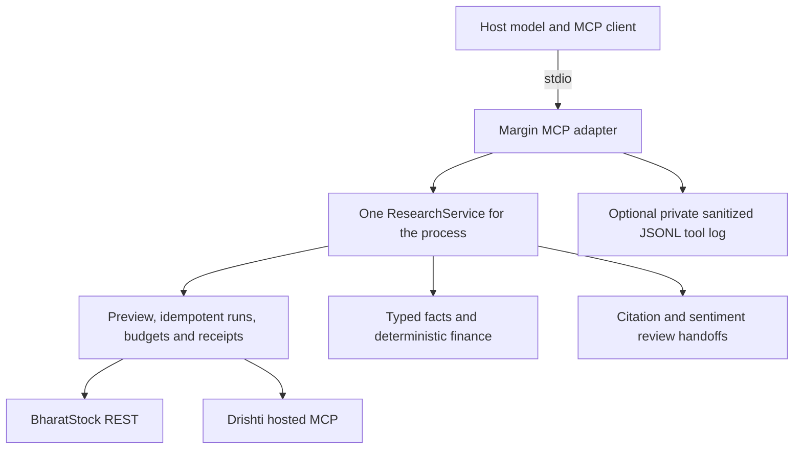

# Margin MCP adapter architecture and implementation plan

Planned **25 November 2026**, after core checkpoint `6b22f57` was pushed and validated
with 194 tests. The user now authorizes MCP implementation. This replaces the historical
proposal; its earlier text remains in Git history. [Core architecture](core-workbench.md),
[finance contracts](../financial-analysis.md), [review workflows](../review-workflows.md)
and [finance support](finance-data-support.md) remain authoritative for underlying behavior.

## Scope and architecture

Build a Python **local stdio MCP server** over the installed official SDK `mcp==2.2.0`.
The existing REST and upstream Drishti MCP adapters remain. No extra web backend, npm
package, database, Margin-side LLM, sampling fallback or public HTTP service is required.
The workbench and agent CLI remain available separately; each independently launched
backend has its own counters, not a shared account-wide allowance.

The transport adapter calls public core methods, not HTTP routes or private run buffers.
Expose a stable workflow surface rather than 47 largely overlapping flat tools. All
13 retrieval, 15 local finance/fact and nine company operations remain discoverable;
ten review functions are separately discoverable in the same catalog. Nested names
must match those reviewed allowlists. Never expose Drishti's generic native executor.

## Planned public tool surface

| MCP tool | Core behavior | Provider calls |
| --- | --- | --- |
| `margin_status` | Mode, process ID, provider readiness and ledger | none |
| `margin_catalog` | Summary or filtered exact schemas for retrieval/calculation/company/review | none |
| `margin_preview` | Preview one to eight approved retrieval/local-calculation operations | none |
| `margin_company_preview` | Resolve retained financials versus one explicitly allowed dependency | none |
| `margin_run` | Submit existing plan with process ID and idempotency key; optional bounded wait | only planned operations |
| `margin_run_status` | Inspect a run, optionally wait at most 30 seconds | no new operations |
| `margin_result` | Retrieve one retained sanitized result | none; never refetch |
| `margin_sources` | Available retained financial responses | none |
| `margin_facts` | Typed facts with `auto`, explicit scale or unknown policy | none |
| `margin_calculate` | One of 15 explicit-input calculations directly | none |
| `margin_cancel` | Explicitly cancel a run, preserving uncertain-dispatch accounting | no retry |
| `margin_connect_drishti` | Explicit upstream metadata lifecycle action, guarded by process ID | bounded metadata HTTP |
| `margin_review` | One of ten local citation/sentiment functions | none/model-free |
| `margin_review_sources` | Import retained source text into the review store | none |

Catalog summaries omit bulky schemas by default. Exact schemas are requested by name
and group. Preview operations still receive strict core validation, holds, bounds and
cost estimates. Company functions retain the existing `fetch_missing: false` default.
Independent calculations and review actions do not require a preview since they cannot
fetch data. Partial/incomplete financial results are valid domain outcomes, not invented
values or transport failures. Pure calculations have no hidden source lookup.

## Lifecycle and contracts

- Create one core service in MCP lifespan; close all tasks/providers on EOF/shutdown.
  Tool listing, initialization and status must not connect to providers.
- Generate an opaque process/session ID. Preview returns it; run and Drishti connection
  require it. A restarted process rejects old handles before paid dispatch.
- Preserve core plan expiration, idempotency keys, shared concurrency/allowances and
  Drishti metadata checks. Run/status waiting is bounded to 30 seconds and shielded;
  cancelling a tool-call waiter does not silently replay/cancel an already submitted run.
  Use `margin_cancel` for explicit run cancellation. Retry submission only with the same
  plan/key; uncertain upstream outcomes are not automatically retried.
- Return both structured JSON and JSON text for older clients. The envelope contains
  adapter contract version, process ID, mode, tool and data or safe error. Financial
  definitions, units, source paths, unverified labels, receipts and limits stay intact.
- Validate tool schemas and 64-KiB input bounds before dispatch. Reject unknown keys,
  nonfinite numbers, arbitrary operation names and credential-bearing arguments.
  Sanitize errors and bound output; never print secrets, raw exceptions or HTTP headers.
- Protocol messages alone use stdout; diagnostics use stderr. No real keys in config
  examples, tool arguments, source, Git, skills or bundled wheel metadata.
- Optional `why` is one visible line (1–280 chars), an agent self-report rather than
  hidden reasoning. Optional operator-configured JSONL recording stores sanitized
  request/result events. Logging is off by default, private 0600, and outside product
  imports of the research harness. Pre-dispatch write failure stops execution; a
  post-dispatch failure returns the available result with an explicit warning.
- Annotate read-only/idempotent/local versus provider actions accurately. Annotations
  are advisory and do not replace admission/validation. Tool names/schemas are stable;
  current provider availability comes from status/catalog rather than dynamic removal.

## Implementation sequence

1. **Push current core**: source/private-data/secret review, regression suite, commit/push
   checkpoint. Completed: `6b22f57`, no private captures or numerical gold included.
2. **Plan before code**: publish this architecture, mapping and acceptance checklist;
   update AGENTS/context to replace the old no-MCP gate. No runtime changes in this step.
3. **Thin adapter**: `src/margin/interfaces/mcp/{server,tools,recording}.py`, module launcher
   and `margin-mcp` entry point. Explicit `--mode`, optional local credential file and
   optional recording path; normal provider configuration continues through environment.
4. **Tests**: direct handler contract/guard tests, SDK client over real stdio subprocess,
   complete fictional retrieval/finance/review workflows, restart/idempotency/cancellation,
   logging, output redaction and shutdown. Existing core/CLI/workbench tests must pass.
5. **Package and document**: build/install the wheel in a separate target, exercise its
   stdio launcher, provide host-neutral configuration and a fresh-chat starter. Host
   inference/benchmark runs remain a separately labelled next gate.
6. **Push adapter**: final source/artifact scan, commit and push the tested alpha. Retain
   diagnostics privately; do not rebuild old 16-November evaluation archives.

## Acceptance gates

| Gate | Required observation |
| --- | --- |
| Protocol | SDK initialize, stable 14-tool list, valid tool schemas/results, text and structured output, clean stdout/EOF |
| Full reachability | Catalog accounts for all 37 retrieval/finance and ten review functions; exact schemas discoverable |
| Cost/state | No startup/list/status/preview/fact/review fetch; repeated run key dispatches once; stale process rejected |
| Domain limits | Unknown/missing/held inputs remain explicit; scope/unit/TTM safeguards survive transport |
| Lifecycle | Explicit cancellation and shutdown drain tasks and close upstream sessions; no automatic retry |
| Logs | Why is optional/validated; logs off by default; configured logs are sanitized, private, ordered and bounded |
| Packaging | Wheel includes adapter/entry point, excludes credentials/research answers/private results; isolated launch works |
| Host | Actual MCP SDK transport exercised; model-host decision quality is not inferred from protocol tests |

First implementation validation uses fictional software fixtures, clearly labelled,
with **zero authenticated provider/model API requests**. The earlier real core results
are evidence for provider behavior, not a new MCP-host test. Any later real MCP probe
needs its own bounded budget; paid plans are not a prerequisite for packaging.

Reference baseline: [MCP tools specification](https://modelcontextprotocol.io/specification/2025-11-25/server/tools)
and [official Python SDK](https://py.sdk.modelcontextprotocol.io/). The installed pinned
SDK's constructor callbacks/lifespan/stdio APIs were inspected locally; do not copy v1
decorator examples or silently upgrade dependencies for this adapter.
