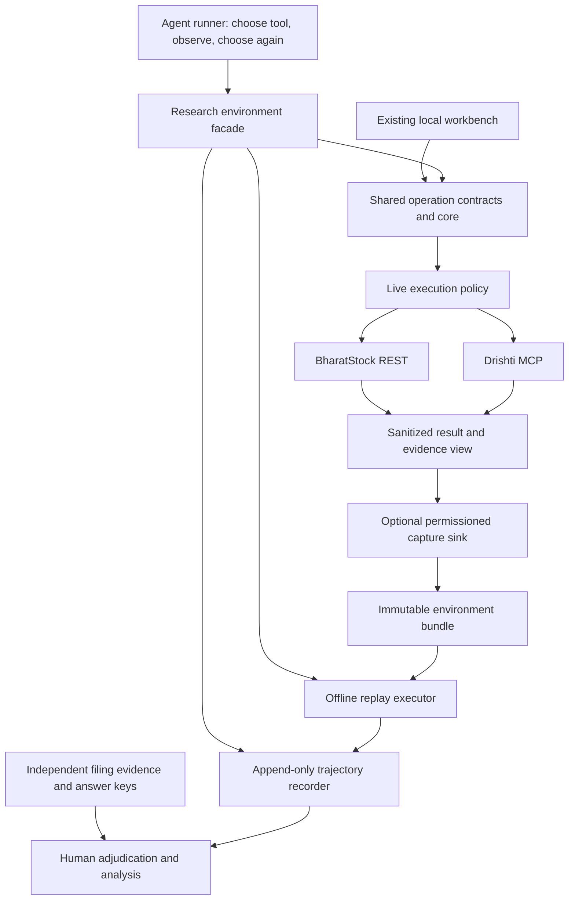

# Margin review and research-environment integration plan

**7 November 2026. Review and proposal only; no new runtime implementation or authenticated collection.**

This reviews the current repository, the [29 October finance/protocol proposal](analysis-and-protocols.md), and Nikhil George's supplied **“Margin: The Research Vision and the First Public Release” (2 November)**. The note is a proposed research direction, not evidence that its capabilities already exist or authorization to purchase, collect, publish or contact providers. [Implementation status](../implementation.md) owns delivered behavior; [delivery plan](../plan.md) owns the revised sequence.

## 1. Recommendation and scope change

Keep the Python core, BharatStock REST adapter, upstream Drishti MCP client and local workbench. Add a bounded research environment alongside the existing live workflow. Do not rebuild the product, restore the old corpus system or require a downstream MCP server first.

The next milestone becomes **a documented tool environment, permissioned frozen responses, independently verified tasks and genuine recorded agent runs**. DCF, sentiment and the full citation/host-assessment workflow remain product work, but are not prerequisites for this milestone. The professor proposes an instrument and its first documented use, not a comprehensive benchmark or leaderboard.

This introduces a specific exception to the earlier transient-data design: an explicitly selected, versioned research snapshot may persist where permission allows. The ordinary workbench remains on demand with expiring results. A frozen study artifact is not a maintained market database; it still requires retention, publication and deletion rules.

## 2. What exists and what it establishes

Inspected `core/service.py`, configuration/contracts/registry, provider adapters, policy ledger, evidence inspection/sanitization, workbench and existing tests/docs. On 7 November, Ruff lint and formatting passed and **50 offline tests passed**. No provider or model calls were made. Fictional fixtures remain appropriate for software regressions; research observations and reported agent experiments must use real, documented evidence.

| Area | Delivered | Review consequence |
| --- | --- | --- |
| Reusable service | Ordinary async `MarginService.execute(OperationRequest(...))`; transport-independent `OperationResult`; injected adapters | A direct agent-tool adapter is feasible without MCP or FastAPI |
| Provider integration | Six BharatStock REST operations; seven reviewed Drishti nested operations through native `execute_tool` | Reuse a task-specific subset; the 25-function reference is not blanket runtime admission |
| Controlled execution | Local schema/selector checks, explicit plans, idempotent runs, provider locks, atomic allowances, uncertain-outcome holds, SDK lifecycle accounting | Retain these for live collection; separate offline experiment budgets from account quotas |
| Evidence handling | Credential sanitization, provider payloads, receipts, reviewed-path warnings, coverage hints and unverified source locators | Useful inputs, but no independent claim verification or comprehensive provenance model |
| Interface | Local FastAPI/static workbench with manual plan/review/run/inspect flow | Useful inspection surface; its predetermined operation list is not an agent trajectory |
| Live evidence | October source trials; user's 21 October eight-call RELIANCE export across both providers | Selected retrieval works; not proof of broad coverage, current entitlements or financial accuracy |
| Research infrastructure | None delivered for immutable snapshots, offline replay, task/gold registry, model runner or trajectory annotation | These are the new critical path |
| Financial/protocol extensions | Detailed proposal; DCF reported as work in progress outside the validated core | No integrated DCF, sentiment protocol or semantic citation verifier should be claimed |

The current registry is:

- BharatStock: `search_stocks`, `get_stock_quote`, `get_stock_fundamentals`, `get_financials`, `get_stock_prices`, `get_corporate_actions`.
- Drishti: `get_news`, `get_symbols`, `resolve_symbols`, `get_announcements`, `get_announcement_categories`, `list_earnings`, `get_earnings_filing`.

The 21 October run establishes current-adapter success for quote, financials (annual and quarterly), ratios, prices, news, announcements and earnings discovery for RELIANCE. Corporate actions and directory/category/identity paths still lack equivalent selected live validation. Earnings detail has earlier upstream evidence, but the real-list detail-selection UI remains incomplete. Schema hashes, implementation, admission and observed execution are separate states.

### Important corrections to assumptions in the note

1. Margin does **not** durably preserve its original observations and transformations. Plans, receipts and results are process memory; payloads normally expire after 1,800 seconds and may be evicted earlier. Shutdown clears them.
2. Receipts preserve selected top-level selectors, not complete request identity. Drishti's nested `query` and other arguments are omitted from that selector summary. A receipt alone cannot reconstruct the call.
3. Provider-shaped sanitized values survive within retained results. Margin does not implement a general normalizer, transformation ledger or financial/corporate-action join. Several warnings are generic cautions, not independently adjudicated case annotations.
4. Source URLs are currently locators, not verified citations. Logos can be misclassified. Failure records may omit provider bodies intentionally; exact original HTTP-byte preservation cannot be claimed.
5. Source findings demonstrate possible comparability problems, not that agents actually fail on them. The note's ₹40/₹20/₹22 EPS example is illustrative, not an acquired real-company case.

## 3. What remains useful from the previous plan

| Earlier work package | Revised position |
| --- | --- |
| Actual news/earnings mapping, correct detail selectors and source-link classification | Fix the subset needed for faithful inspection/capture first; full print polish can follow |
| Typed facts with issuer, definition, period, unit and basis | Implement a minimal observation/lineage contract for selected questions; avoid a universal taxonomy |
| Deterministic comparisons and compatibility checks | Develop small auditable helpers; decide explicitly whether agents receive them or only adjudicators do |
| Citation workflow | First build filing/page evidence and adjudication records for independent answers; retain the broader host-LLM workflow for later |
| FCFF/DCF, scenarios and sensitivity | Parallel optional finance track after input contracts; no research-release dependency |
| Sentiment packets, deduplication, host labels and aggregation | Later experimental/product extension with its own independently labelled evaluation set |
| Versioned research/conflict/citation protocols | Potential experimental conditions after a baseline exists; do not quietly change instructions between models |
| Downstream Margin MCP | Later thin adapter to stable services; ordinary function calling suffices for the first study |
| Direct-provider/aggregation/protocol comparison | Later controlled study using frozen evidence, matched budgets and fixed tasks; not a substitute for this first environment |

## 4. Architecture: one core, explicit live/capture/replay paths



Execution mode selects a path; replay must never fall through to live execution. There must be no network startup, API key requirement, current-account entitlement check or metadata refresh on replay. Live collection retains existing guards. An unsupported replay request returns an explicit environment error, not a cache miss that fetches upstream.

The seam belongs at the transport-independent operation-service boundary. Merely injecting a replay provider into today's `MarginService` is insufficient: live Drishti readiness checks, ledger behavior, current timestamps and newly computed warnings could alter the frozen result. Reuse contracts/validation, but return the stored agent-visible result under the frozen environment policy. A small executor interface is preferable to a new general-purpose framework.

Proposed modules, not delivered APIs:

```text
src/margin/research/
  contracts.py       # environment, request, response, task, event schemas
  identity.py        # reviewed canonical arguments and semantic request keys
  capture.py         # opt-in sanitized write path, manifest and permissions
  replay.py          # immutable lookup, pinned clock, zero live fallback
  environment.py     # tool catalog, admissible requests and session budgets
  trajectories.py    # ordered model/tool events and completion states
  runner.py          # host-model adapter and iterative tool-use loop
  analysis.py        # outcome tables and observable-behaviour summaries
```

Use versioned JSON/JSONL and content hashes initially, with bounded local files and atomic writes. No SQL service, vector store or separate public data server is required. Private captured responses and private answer keys stay outside public source paths. Releasable manifests, schemas, reconstruction recipes and synthetic software fixtures can live in Git; actual data require a deliberate rights-reviewed release process.

### Frozen response and request contracts

| Record | Minimum contents |
| --- | --- |
| Environment manifest | ID/version, artifact kind (`provider_capture` or `filing_reconstruction`), collection interval, knowledge cutoff, code/schema/policy hashes, tool descriptions, request grammar, budgets, coverage, redactions, rights/expiry and checksums |
| Request | Operation/version, full supplied arguments, resolved effective arguments, explicit defaults, identity/exchange, date bounds, page/limit/detail, pinned clock and canonical request key |
| Response | Agent-visible sanitized payload, payload kind, success/empty/blocked/failed/unknown status, warnings, coverage, source locators, original retrieval receipt, request key and content hash |
| Observation/event | Original field path/value, currency/unit confidence, period and basis, revision/publication/ingestion times where known, event identifiers and evidence references |
| Transformation | Input/output IDs, formula/factor, actor, mapping version and evidence; provider adjustment stays `unknown` unless actually established |
| Capture journal | Intent, dispatch, result/write state, actual requests, estimated/observed charge and crash/uncertainty status; no credentials |

Preserve complete arguments **before TTL/eviction**, including failed attempts. Capture should fail clearly on an unwritable journal before a paid dispatch; a post-dispatch write failure must remain recoverable/uncertain rather than trigger an automatic retry. Distinguish the safe provider response view from Margin's enriched view; both are useful where permitted. Never retain a key to make a citation “reproducible.”

Canonicalization must be conservative: stable JSON object-key order is safe; absent/null arguments, consolidation basis, detail mode and different date windows are not automatically equivalent. Resolve relative windows against a fixed environment date with a documented rule. The current overview uses `date.today()` and lookback windows, so it cannot be reused unchanged for replay.

Document a small admissible grammar: company roster, selected operations, explicit periods/windows and bounded page/detail choices. Agents can choose among those actions; arbitrary provider requests need not be supported. Freeze list ordering and pagination. Supported empty, unsupported, blocked, malformed and recorded provider failure must remain distinguishable.

Freeze the information delivered to agents, including warnings, missing values and transformations. Do not rerun newer result inspection over old payloads while claiming the same environment. Separate original retrieval time/cost from experiment wall time and offline tool-use counts. Stable response content should not depend on newly generated UUIDs or real-time timestamps; identify any excluded operational fields explicitly.

### Independent objects and separation

- **Environment:** what can be discovered, not just calls made in one run. A transcript from a previous run is insufficient coverage for a different agent.
- **Trajectory:** actual visible messages, calls, responses and answer; references the environment and response hashes.
- **Answer key:** independently grounded filing evidence, definitions, arithmetic, qualifications and permissible abstentions. It is not served through agent tools or accessible in the runner's filesystem.

Known transformations are part of evidence, not an automatic oracle. A bonus event must not cause Margin to adjust an already-restated EPS again. Financial interpretation remains definition-specific. If a future helper explains the adjustment, its availability and guidance become part of a separately versioned experimental condition.

## 5. Candidate tasks, data and feasibility

Start with two development companies for integration, then aim for **three release companies**, expanding to approximately six only if coverage and independent verification support it. RELIANCE/TCS are continuity candidates, not the predetermined research roster. Select release companies under a documented rule before inspecting agent outcomes: accessible filings, usable periods, suitable financial definitions, some bonus/split exposure and controls. Record rejected candidates and reasons. Avoid tuning questions against test-model failures.

| Candidate ordinary question | Minimum evidence | Existing retrieval path | Remaining feasibility gate |
| --- | --- | --- | --- |
| How did annual basic EPS change between two named years? | Current/prior EPS, basic/diluted definition, original/restated comparative, reporting basis; relevant share-action evidence | BharatStock annual `get_financials`; `get_corporate_actions`; Drishti earnings list/detail and announcements | Corporate-action path unobserved live; provider adjustment policy unknown; historical periods may be outside trial windows |
| What was the latest reported profit as of a fixed date? | Release date versus ingestion, period length, consolidated/standalone and group/owner-attributable profit; amendment status | Quarterly `get_financials`, Drishti `list_earnings`, selected `get_earnings_filing` | Numerical/event freshness differs; independently verify the latest eligible report, not simply last array item |
| How did dividend per share compare across two fiscal years? | Interim/final/special dividends, declared/paid convention, per-share basis and action dates | Corporate actions plus relevant announcements and issuer dividend notes | No delivered DPS aggregator; validate historical action coverage and convention before selecting tasks |
| Did operating cash flow cover capital expenditure? | Annual net CFO; defined cash capex, sign convention, period and basis | Annual `get_financials`; earnings detail if sufficient; issuer cash-flow statement | Quarterly cash flow is null; capex is not established as a reliably returned field; do not substitute total investing cash flow |

This is a feasibility matrix, not a claim that all four tasks currently work. Independent answer keys require original filings and page/table references for every selected case. If a needed fact exists only in the private gold evidence, an agent cannot be expected to retrieve it: either expose a permissioned filing lookup in the environment, define evidence insufficiency as an acceptable answer, or exclude/rewrite the task under the predeclared rule.

A small filing-evidence operation may therefore be necessary. Proposed `evidence.get_record(record_id)` returns an indexed page/passage plus document identity, date, page and hash. A bounded search over that selected evidence can follow if required for discovery. It must use real, permissioned issuer material and be offered consistently across cases, not only when a hidden pitfall occurs. Gold annotations and correct answers remain separate. Publicly downloadable filings are not automatically licensed for wholesale redistribution.

For time validity, pin the question cutoff, snapshot acquisition interval and eligible publication dates. A later restated comparative cannot silently answer an earlier historical-as-of question. If collection contains later knowledge, restrict the available view or frame the task as research performed at collection time. Unknown dates remain qualifications.

Answer-key records should include `task_id`, exact question, issuer/as-of definition, filing/version/hash, page/table/cell, metric definition, unit/basis, selected values, reproducible calculation, rounding/tolerance, accepted alternatives, insufficiency conditions and reviewer/adjudication status. One contributor prepares; another independently checks without looking at agent answers. A host LLM can assist extraction, but cannot make its own assessment independent gold.

## 6. Provider rights, subscriptions and collection cost

Public pages were inspected on **7 November 2026**, without account access. Published terms are evidence of restrictions, not a determination of the team's account agreement; obtain the applicable sign-up agreement/permissions before deciding the release form.

**BharatStock:** its terms distinguish agent request-time querying from internal model evaluation, included on Developer/Pro rather than Free/Starter/Growth. Local evaluation storage does not confer raw-data redistribution rights; a public dataset/service needs separate scope confirmation. See [terms, particularly clauses 7–10 and 24](https://bharatstockapi.com/terms). The REST architecture remains unchanged: the new plan question concerns use rights, not a technical need for BharatStock MCP.

**Drishti:** the published terms distinguish internal use, end-user display/programmatic re-exposure, redistribution and AI-use permissions, with platform agreements taking precedence. They also reference additional retention/AI policies and termination deletion obligations. Public replay, publishing response-bearing trajectories and use through external model providers therefore need explicit scope confirmation. See [terms, sections 2, 5, 7, 16 and 21](https://drishti.manasija.in/legal/terms-and-conditions). Do not assume a Starter purchase resolves this.

Published access/pricing checkpoints:

| Provider | Public page on 7 November | Planning implication |
| --- | --- | --- |
| BharatStock | Starter ₹500/month, Developer ₹1,500/month; Developer advertises 10,000 requests/day and model evaluation. Public Free advertising now says 60/day | The supplied historical 25/day key may differ; verify account entitlement. Developer is the candidate for internal research evaluation, not a public-release licence. [Official pricing page](https://bharatstockapi.com/) |
| Drishti | Sandbox 1,000 trial credits; Starter ₹2,000/month, 10,000 credits/cycle, published REST 60/min and 60,000/day. MCP table: news 1, announcements 1/2, earnings list 2/3, detail 3 credits | MCP costs are distinct from REST per-item pricing; published REST throughput does not prove identical effective MCP bounds. [Official pricing](https://drishti.manasija.in/docs/pricing) |

A candidate paid **internal** combination is therefore BharatStock Developer + Drishti Starter, **₹3,500/month before tax and any additional rights/model costs**, subject to permission and actual need. It supersedes the old ₹2,600 Starter/Starter figure for this new evaluation purpose. No purchase is needed for offline software work; current account balances, trial validity and negotiated research rights are unknown.

Estimate collection from **unique admissible requests**, not 48 trajectories. A planning envelope for six companies is:

- BharatStock: one annual financials request, one quarterly request and one action request per company = **18 logical REST requests**, assuming each fits one page and required history. Identity lookup, extra periods/pages and diagnostics are additional.
- Drishti MCP: one earnings list (2), one summary announcement call (1), and two detail calls (2 × 3) per company = **9 estimated credits/company, 54 total** under the published per-operation table. That is **24 logical data operations**; optional one news request/company adds 6 operations/credits.
- SDK initialize/catalog/schema/lifecycle/cleanup traffic, safe account reconciliation and a diagnostic reserve add HTTP requests. Do not equate 24 data calls with 24 transport requests or assume today's default 30-request local cap fits collection. Budget those measured overheads before dispatch; validate rate limits separately from credits.

These are arithmetic planning bounds, **not a complete collection quote**: detail selectors may require discovery, pages may be insufficient, annual capex/DPS may be absent, and history/source rights may require a different plan. Record a concrete per-request manifest before authorizing collection, with worst-case selected pages, version checks, cleanup reserve and stop conditions. Never exhaust pages automatically.

Once a permitted environment is frozen, 24 or 48 **offline replay** trajectories make zero upstream provider calls. Model tokens, annotation effort and any model-provider data-transfer conditions remain separate. Obtain a model budget after models, output/step limits and response sizes are chosen; no credible rupee estimate is available yet.

### Release paths and the feasibility decision

| Path | What can be promised |
| --- | --- |
| Exact public capture, if expressly permitted | Publish the approved frozen agent-visible responses and compatible logs; new agents can encounter the same information |
| Restricted provider collection | Publish code, permitted tasks/annotations/analysis and clear access instructions; exact replay only for authorized users with required artifacts; disclose missing public reproducibility |
| Public issuer-filing reconstruction, if its materials are releasable | Publish a separately identified environment and run agents on that environment; do not call it the original provider snapshot |

Response-bearing trajectories can reproduce restricted data even when snapshot files are omitted. Redacting or reconstructing data changes the environment's information; label the new version and rerun experiments before associating results with it. Never publish a reconstruction beside old private trajectories as if they shared one environment.

## 7. Genuine agent execution and evaluation

Build a small model-agnostic loop: supply the frozen tool catalog and ordinary question, let the model choose a call, validate/execute it against replay, return that response, then let it decide again until an answer or limit. Sequential calls are sufficient initially. The existing manual overview remains useful to humans but must not prefetch answers for the experiment.

The controlled runner must mediate all evidence access. Disable extra browsing/provider tools and isolate answer-key files; record any additional tools if later allowed. Model pretraining knowledge cannot be removed, so document that limitation. Tool-output text is untrusted evidence, not authority to change instructions or access secrets.

Each run records environment/task/tool-profile IDs and hashes, code/model version, prompts/configuration, seed where supported, ordered visible messages, tool names and full sanitized arguments, response references/content, final answer, stop reason, token/tool budgets, usage/cost and failure events. Persist incrementally, record incomplete/crashed runs, and never silently overwrite a failed trial with a successful retry. Record visible explanations only; do not request or claim access to hidden chain of thought.

Target two models × six companies × four tasks = **48 trajectories**; a three-company pilot gives 24. These are targets, not gates. If some task families are infeasible, report the smaller task matrix rather than filling it with invented values. One run per task/model is descriptive evidence, not a stable model ranking; repeated runs are a separately budgeted later study.

Outcome codebook: **correct, incorrect, justified abstention, unjustified abstention, indeterminate**. Separately record environment mismatch, unsupported call, time/tool exhaustion and technical failure. Detailed annotations for a subset cover conflict encountered, alternative requested, source selected, explicit qualification and observable double adjustment/first divergence. Lack of a visible action is not proof about an internal belief.

Report correctness/abstention counts alongside task coverage, unsupported calls, source-use traces, cost and technical failures. Predeclare denominators and exclusions. Compare models on the same environment, tools, instructions and budgets. A challenge-enriched sample cannot estimate the prevalence of financial-data problems in Indian markets.

The planned protocols become explicit profiles: baseline with the existing frozen warnings; optional guidance; optional deterministic helpers; later citation/sentiment workflows. Keep profiles separately versioned, pair comparable tasks and change one factor at a time where possible. A protocol that tells agents the answer to a case changes the experimental question; it is not free evaluation improvement.

## 8. New and extended functionality, in priority order

| Priority | Proposed function/component | Acceptance |
| --- | --- | --- |
| P0 | Environment manifest, capture journal, canonical request identity | Full nested arguments, pinned windows, hashes, redactions and rights recorded; bounded writes before expiry |
| P0 | `environment.list_tools`, `describe_scope`, `call_tool` over replay | Offline, stable information, real choices, supported-empty versus unsupported, no network fallback |
| P0 | Task/evidence/gold schemas and reviewer workflow | Ordinary fixed questions; filing-based derivations and insufficiency labels independently checked |
| P0 | Runner, trajectory recorder and analysis scripts | Iterative model decisions; complete/incomplete logs; reproducible outcome tables |
| P1 | Selected actual-shape/detail/citation repairs | Real record selectors and source roles preserved; safe, readable inspection without another paid fetch |
| P1 | Minimal `facts.check_compatibility`, unit conversion and period comparison | Explicit issuer/definition/unit/basis; reversible mappings; missing values remain missing |
| Conditional P1 | `evidence.get_record` and bounded filing search | Add only if needed for agent-observable evidence; no gold leakage; rights and coverage documented |
| P2 | `citation.prepare_verification_task`, `submit_assessment`, numeric/quote checks | Host judgment separated from deterministic checks and independent answer keys; versioned as experiment condition |
| P2 | `finance.prepare_fcff_inputs`, `calculate_dcf`, `run_scenarios`, sensitivity | Explicit inputs/assumptions, valid discount/terminal conventions, independent reference calculations; no silent data completion |
| P2 | Sentiment packets, deduplication, `submit_labels`, aggregation/protocol | Evidence-linked labels, independent labelled sample, coverage-qualified tone rather than market-wide investor sentiment |
| P3 | Downstream MCP and broader provider search/concall tools | Thin adapter over tested services; host discovery and real-host tests; expand only for demonstrated tasks |

Function names above specify design intent, not current callable endpoints. The detailed product contracts remain in the [finance/protocol proposal](analysis-and-protocols.md); its earlier first-release ordering is superseded by this review.

## 9. Implementation sequence, ownership and gates

Planning estimate: **roughly 3–5 working weeks for four contributors after feasibility/permissions are settled**, depending on filing quality and model access. This is not a deadline commitment; external permissions can dominate the schedule. Keep DCF optional and reduce company/task count before weakening evidence quality.

| Stage | Work and outputs | Gate |
| --- | --- | --- |
| 0: feasibility, roughly 2–3 days of team work | Account/terms matrix; operation-to-question coverage; development-company source check; collection request/cost manifest; choose exact/restricted/reconstructed route | At least one coherent task family with independent filing evidence and an allowed capture/experiment path |
| 1: foundation, roughly 4–6 days | Capture contracts/journal, canonical arguments, immutable manifests, replay executor; targeted result-mapping repairs | Same supported request returns same information offline; unsupported/empty/failure paths pass; no live regressions |
| 2: cases and evidence, parallel 4–7 days | Predeclare/fix release roster and questions; permitted bounded collection; independent filing keys and cross-review; freeze environment and task/gold versions | Every evaluated task has sufficient observable evidence or a justified-insufficiency key; rights and transformations explicit |
| 3: experiments, roughly 3–5 days | Small runner, logging, development smoke runs, fixed configurations; final-model runs after freeze | Genuine iterative choices; logs complete or explicitly incomplete; no answer-key leakage or undeclared tools |
| 4: inspectable release, roughly 3–5 days | Human labels/subset annotations, reproducible analysis, worked case, data card/codebook, rights-reviewed package and clean-room run | Claims match actual released files and access conditions; all listed reproduction commands work |

Suggested human responsibilities: core contributor owns capture/replay and stable contracts; finance contributor (including Advait) owns definitions/calculations and first-pass keys; evidence/provider contributor owns permissions, filing provenance and independent key cross-review; integration contributor owns runner, trajectory inspection, reproduction and documentation. Review each other's cases before seeing agent outcomes. Every stream owns tests/docs; these are not instructions to spawn agents or contact providers.

Test gates include full nested-argument identity, safe default resolution, frozen dates, changed-policy detection, tamper hashes, result ordering, supported-empty versus unsupported, failure replay, blocked network access, no account spending in replay, sanitization, crash/write uncertainty and no gold exposure. Finance cases need independent arithmetic and basis review, not tests that merely repeat the implementation. Runner fixtures should demonstrate that the second tool action depends on the first response and that all observed events are logged.

Release materials: releasable code/tests, environment manifest/tool grammar, permissioned records or clearly labelled reconstruction/restricted instructions, fixed tasks, independently reviewed answer keys, trajectories, annotation codebook, data card, worked example and analysis/replay/recollection scripts. **Rebuilding analysis, replaying evidence and recollecting live data are three separate claims**, each with its own tested instructions and limitations.

## 10. Immediate decisions and limits of this review

The architectural integration is feasible using existing service boundaries. Research completeness is not established: corporate-action coverage, capex availability, exact provider adjustment semantics, full collection cost, current account access, model access and release permissions remain open. None is resolved by the existing 50 tests.

The next concrete work item is Stage 0's feasibility sheet and small real-evidence development pilot, followed by capture/replay before final study collection. Do not run another broad overview simply to fill a dataset. Old private diagnostics have overdue manual retention-review dates; this plan neither reuses them nor extends their retention. No runtime feature, purchase, provider outreach, model experiment, commit or push was performed for this review.
