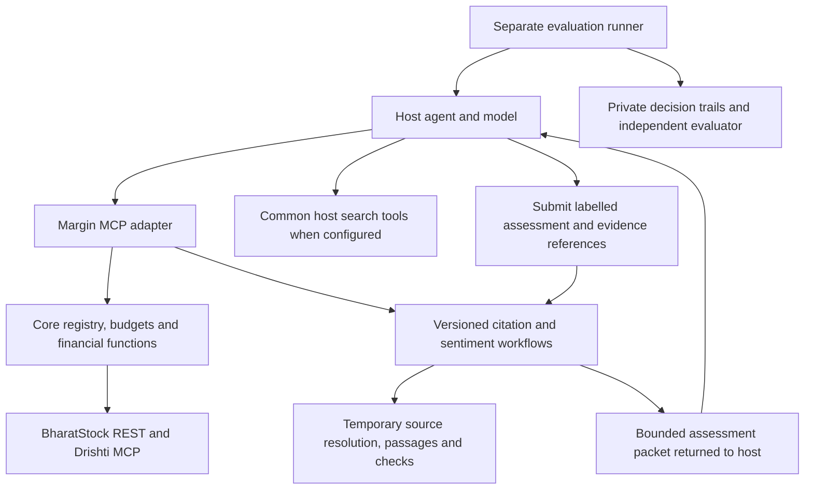

# Margin build and evaluation plan

## Current next steps after the 0.9.0 review repair

1. User activated 0.9.0 and completed the new review flow in advanced review16 with
   one recovered host error. Change only frontend --tool-profile to review-simple,
   reconnect and test the complete task in a fresh chat; no owner restart/budget reset.
2. Preserve a fresh first-attempt Qwen run plus missing-input/wrong-date/false-quote
   controls. Compare with the frozen 0.8.2 preset-assisted failures as a new condition;
   record context, profile and preset rather than attributing everything to context size.
3. Test another capable model/host for end-to-end completion/final-answer fidelity.
   Do not claim autonomy, semantic ground truth or source authentication from SDK checks.
4. Keep finance/retrieval live tests separate with explicit remaining API allowances.
   Further MCP distribution/hosting and the professor's independent benchmark remain later.

Delivered now: internally bound two-step review, atomic transient sessions, immutable
submissions and optional three-tool interface. No Margin LLM/browser, database, automatic
original verifier or mandatory citation step for ordinary finance. User skipped demo.

**Professor demo delivered, 26 November:** the repo-only SDK client and private real-
text/operator-judgment input are ready; success and wrong-quote commands tested, 437
offline checks pass. See MCP guide. Use this to show core behavior honestly while
model reference/task fidelity is investigated. No new core release, actual inference,
provider call or budget/reset; demo events are a separate observation condition.

**26 November preset-assisted result:** setup/anchor normalization pass, but Qwen3-8B
uses URLs/passage IDs as handles and invents a missing task despite the effective preset.
Preserve the failed condition; compare another model and simplify preparation only under
a separately documented change. User separately requests a professor demo: add a small
repo-only official-SDK client over the existing zero-budget backend. It reads saved real
source text plus explicitly operator-supplied judgments, binds returned references and
prints honest audit/coverage/sentiment limits. No model inference, new provider call,
backend restart or new wheel. Test it with fictional software fixtures and actual saved
text, label its logs separately from model trials, and never present it as model autonomy
or independent verification. The product MCP and old versioned artifacts stay unchanged.

**26 November 0.8.2 robustness pass:** narrow URL-anchor registration repair plus
control-character/extra-normalization rejection, safe field diagnostics, explicit
assessment coverage and financial-only numeric routing. 432 offline tests pass;
exact raw requests and operator replay pass without live calls. Next deliberately
activate the matching wheel with reconciled allowances, then retry the full task
with known model/settings and preserve original first attempts. Do not infer model
success from software checks or make a new data call to repair local review inputs.

**26 November full-task outcome:** seven INFY calls still leave the protocol incomplete:
metadata-only registration, guessed references and rejected quotation; two unreviewed
claims, no sentiment aggregate. Next use the same complete task in a separately labelled
short-preset/skill condition, stressing actual passage registration, returned references
and error-aware reporting. Preserve the original failed run; do not force a semantic
label or turn coached recovery into baseline success. No runtime change/fetch authorized
by this observation alone. [Implementation](implementation.md) owns the measured audit.

**26 November instruction-delivery review:** the explicit retry omitted the actual
task/source (user confirmed) and invented a different task. Preserve it as a missing-
input case; next use the complete one-file real Infosys prompt and record model/context.
Then compare MCP-only, a compact host preset and the existing skill on a supporting
host, keeping settings fixed. See [review](design/mcp-aggregation.md#instruction-delivery-review-26-november-2026).
No runtime repair, skill install, API call or active backend change in this review.

**26 November first 0.8.1 unguided outcome:** the host answered supplied text without
admitted review calls; setup status passed. Preserve this omission and separately test
a goal requiring actual Margin review records/audit/aggregate outputs, without naming
functions. Distinguish optional tool selection, artifact-required workflow execution
and coached routing conditions. No runtime patch or renewed provider allowance follows
from this observation; [implementation](implementation.md) owns evidence and limits.

**26 November 0.8.1 delivered:** optional citation protocol with declared host reading
access, clear no-reader/no-text/inventory fallbacks and original-reading handoff steps.
No change to finance/retrieval math or tool counts; 403 offline tests and SDK checks
pass. Plan dfd3113 preceded code. [Unguided acceptance prompts](review-workflows.md#next-tests-and-unguided-acceptance)
now own the next operator tests. First test supplied text, a missing-text locator and
a contradiction in fresh model chats without function instructions. Then, under a
separate explicit live allowance/full profile, test finance and event selection.
Reader-host original review is a separate capability condition, not a universal
requirement. Finally broaden real coverage, freeze version/profile/tasks/settings and
run the independent model benchmark; complete clean-install/public-release checks.
Keep citations optional. No active upgrade/restart, allowance reset, new provider/model
API call or purchase was performed by this build.

**26 November host gate completed:** the 0.8.0 review profile now completes one
guided real-text citation/sentiment round trip in LM Studio, nine admitted calls,
zero provider attempts. Preserve the private run and earlier failures; do not patch
the runtime for remaining model prose errors. Next validate contradicted/insufficient
claims, incorrect quotes and ambiguous/excluded sentiment/date cases with separate
packets. Then freeze package/profile/tasks, identify model/context/settings and run
the independent with/without-Margin benchmark. Original-document verification and
market sentiment are not established by this one supplied summary. No new provider
call, backend restart, purchase or budget reset follows from this checkpoint.

**0.8.0 review repair delivered:** typed schemas for ten review functions, precise
diagnostics and actual next-step bindings; optional 14-tool frontend review profile
over the same state owner. No hidden judgment generation or provider call. Software
and saved-real-text operator acceptance preceded the guided host trial above. See
[evaluated plan](design/mcp-aggregation.md#080-review-repair-plan-and-evaluation-26-november-2026)
and [implementation](implementation.md). Upgrade deliberately; profile changes alone
must not restart the backend/reset budgets. Then test one typed preparation/submission
step at a time before freezing the separate benchmark profile.

**0.7.0 usability repair:** evaluated plan df45376 adds four generated typed event
previews, precise retrieval errors and explicit status version. Generic contracts
remain compatible and exact schema sources are documented. Software validation
does not establish model improvement; next is the one-source typed-preview host
test after deliberate activation. No additional paid API calls or active restart
are part of this build. [Architecture/evaluation](design/mcp-aggregation.md#070-typed-retrieval-preview-plan-and-evaluation-25-november-2026)
and [implementation](implementation.md) own details.

**25 November stage delivered, 0.6.2:** the user authorized the bounded Drishti pass.
All four INFY data calls worked; source-import defects were repaired and saved real
response citation/content-sentiment handoffs tested. A host-read issuer webpage
separately checked the reader-enabled route. See [implementation](implementation.md).
Next: controlled activation and one-source LM Studio acceptance, then freeze the
product/tool profile for the separate benchmark. Wider native operations (concall/
search), independent numeric gold and model comparisons remain future work. The
following proposal is retained as the plan preceding these results.

## Next validation stage: Drishti → citations → sentiment, 25 November 2026

Treat 0.6.1 finance as a baseline with known model raw-unit/prose limitations; avoid
repeated financial micro-patches unless a new core defect is reproduced. The MCP is
already packaged. This next sequence is proposed, not permission to make new provider
calls, restart the active backend, reset allowances or purchase a plan.

1. **Drishti slice:** refresh/review current native and admitted schemas before paid
   work. Exercise one known company with a bounded news page, one summary announcement,
   earnings discovery and one detail selected by returned ID. Check identity/date/date-
   kind, missing fields, source links, sanitized protected URLs, readiness/holds and
   actual HTTP versus estimated credits. Seven Drishti operations already exist;
   the upstream catalog's 25 operations are not all exposed. Preserve extraction=false
   and schema quarantine. Publish a separate explicit call/credit/cleanup allowance
   before execution; current Drishti budgets are zero and trial balance is unknown.
2. **Citation round trip:** use those bounded sources for a few supported, contradicted
   and insufficient-evidence claims; register/import text, prepare a packet, receive
   host assessment, validate quotes/references/numeric context, render citations and
   audit the claim manifest. Ten review/workflow functions already exist. Test one host
   with original-source reading and a no-reader inventory/provider-text fallback.
   Matching supplied quotes is not source authenticity or semantic proof. Evidence
   packets are bounded transient memory, not a maintained corpus.
3. **Sentiment:** reuse eligible retrieved material without refetching; annotate issuer/
   aspect/time-scoped passages in the host, then aggregate deterministically. Test
   mixed/unclear, missing labels/dates, duplicate sources and unsupported hosts. This is
   sentiment of retrieved content, not a comprehensive investor-sentiment measurement.
4. **Usability repairs only where measured:** adapt schemas/routing/compact records or
   packet-preparation helpers if the small-model test shows a reproducible gap. Keep
   function math/quote checks in Margin and semantic judgments in the user's host.
   Concall retrieval/transcript search are candidate next source additions after the
   admitted paths pass; they require reviewed schemas, cost/entitlement checks and tests.
5. **Then evaluate:** freeze a tested product version and run the separate multi-model
   with/without-Margin study, tracking tool success, source/answer fidelity, completeness,
   cost and visible why summaries separately. No hidden-reasoning capture or product
   dependency on independent gold/research infrastructure is implied.

Public [Drishti MCP guide](https://drishti.manasija.in/docs/guides/drishti-mcp) and
[pricing](https://drishti.manasija.in/docs/pricing) were rechecked for this recommendation.
The Sandbox's published trial does not prove this account's remaining credit balance
or every MCP operation's entitlement. Start with existing access if sufficient;
upgrade only on a demonstrated access/volume need. MCP lifecycle HTTP and advertised
REST quotas are separate measurements. No authenticated provider/model calls occurred
in this planning review. See [review workflow contracts](review-workflows.md).
Earlier dated plans below are historical checkpoints; this proposed sequence
supersedes their pre-MCP priorities.

**25 November 0.6.1 metadata repair:** plan `bf43c96` owns the confirmed inherited-
formula defect. Per-result formulas are corrected without changing numeric math,
units or data access. Latest user-led test evidence separates backend metadata from
model omissions/raw-unit prose. Next useful no-fetch test: existing HUL key, every
report row including the calculated margin. A new patched live process/acceptance
is a separate deliberate activation with reconciled allowance. No budget reset,
new data fetch or final-answer verifier is part of this patch.

**25 November 0.6.0 reporting repair:** the [plan](design/fetch-and-calculate.md)
published as `1ffec64` now delivers canonical structured rows and
opt-in raw details. No generated summary or Markdown table. Software and saved HUL/INFY presentation checks precede a new
host test. Point 4 (host-enforced final prose validation/rendering) is deferred;
it is not a prerequisite for this patch. Next: inspect the offline reports without
new data calls, then deliberately upgrade the version-matched backend/frontend
and budget a fresh model acceptance only if needed. Do not reset the active spent
0.5.0 allowance or count formatter checks as a model success.

**25 November 0.5.0 delivery:** [self-contained fresh-finance](design/fetch-and-calculate.md)
was implemented after publishing plan `0e9710c`. The ticker-based tool now fetches and
calculates without prior source handles; local preview, bounded calls and process-local
duplicate control remain. Software/packaging checks are in implementation status.
Next: controlled version-matched installation, reconcile provider allowance/Developer
evaluation access, then one fresh HUL margin and, if history permits, one growth test
on a new ticker. Do not silently restart the existing live backend. Source verification,
event coverage, broader host/model acceptance and the independent benchmark stay
separate gates; no live calls/purchase are part of this build.

**25 November 0.4.0 delivery:** implement the planned financial views, six strict direct financial tools and optional Unix-socket state owner. Code, 252 offline checks, source/installed protocol checks and local shared configuration are complete; evidence and limitations are recorded in implementation status. The next user-facing gate is a fresh LM Studio retest of schema construction, two-turn preview/execute, source reuse and financial reporting. No provider/model calls are implicitly authorized by these release checks.

**25 November authorized fidelity/reconnect pass:** implement the [financial fidelity and reconnect plan](design/mcp-aggregation.md#implementation-plan-financial-fidelity-and-reconnects-25-november): deterministic financial views, six strictly typed common calculation tools, and optional explicitly started Unix-socket shared backend. Preserve standalone mode and all spending/scope/state guards. Use offline and saved-response validation; no new authenticated provider/model calls are planned.

**25 November host-feedback patch (0.3.1):** explicit catalog execution routes and protocol unknown-tool errors are implemented after the LM Studio/Qwen naming failure. The first host trial established status/catalog only. Repeat it in a fresh chat after upgrading and selecting a new recording filename; do not invent fact context. The patch passed 224 offline tests; latest-revision conformance, clean cross-platform installs and complete real-host/live acceptance remain separate gates.

**25 November release research:** [distribution and standards evaluation](design/mcp-aggregation.md#distribution-and-live-release-evaluation-25-november) recommends a local Python/BYOK release first, followed by optional registry publication; hosted HTTP is a separate phase. Before release, repair unknown-tool protocol errors, test 2026-07-28 alongside legacy behavior, validate clean artifact installs and actual hosts, and run a bounded live pass. No hosting or public package publication has occurred.

**25 November delivery checkpoint:** the planned stdio MCP alpha is implemented as package 0.3.0, with 14 workflow tools, 220 tests and source/isolated-wheel protocol acceptance. Core/data limits are preserved. [MCP usage](mcp.md) and [implementation](implementation.md) own delivered behavior/evidence. Next gates are a fresh-chat host trial, a separately budgeted live MCP probe and versioned model comparisons; no model-host result is inferred from SDK tests.

**25 November MCP implementation plan:** core checkpoint `6b22f57` was pushed after 194 tests and a source/private-data review. The user authorizes the local stdio MCP alpha. [MCP architecture and acceptance](design/mcp-aggregation.md) now owns the 14-tool mapping, lifespan, state/budget/logging boundaries and sequence. This planning revision precedes runtime implementation; no provider/model requests are planned for initial protocol checks.

## Active repair pass: 24 November 2026

**Completed core pass:** documented units, normal-quarter eligibility, continuing-profit guards, eight additional finance interfaces, reviewed summary announcements and tests are delivered. See [implementation](implementation.md), [current function matrix](reference/function-validation.md) and [finance decisions](design/finance-data-support.md). Missing quarterly CFO/capex, automatic forecasts and full original-source validation remain limits. The numbered plan below records the agreed implementation sequence.

Authorized scope: repair HUL findings, establish finance/data support and implement useful
data-supported functions before MCP packaging. Preserve existing work and old private packets.

1. Review the issuer's Q2 result tables to reconcile product-sales versus total revenue;
   retain metric identity, period, basis and source locators instead of overwriting providers.
2. Add explicit auto/documented unit handling with raw-value/evidence lineage, preserving
   unknown and caller-declared modes. Map balance-sheet stocks separately from flow facts.
3. Establish quarter starts only under reviewed provider metadata rules (explicit duration
   markers present, normal calendar-quarter end, no longer/derived-period flags); reject
   cumulative, missing-marker and ambiguous cases. Propagate basis-change warnings.
4. Add deterministic balance-sheet and cash-conversion metrics plus retained-company
   wrappers and a financial-data readiness function. Readiness explains missing fields,
   periods and assumptions; it must not imply a general accuracy verdict or fetch extra pages.
   Keep existing margins/growth/CAGR/TTM and explicit FCFF/DCF/scenarios/sensitivity.
5. Inspect changed announcement inputs, update only reviewed contracts and retain strict
   drift/selector/cost bounds. No generic schema bypass or unrelated native tool exposure.
6. Validate regression/reference math, service/CLI/HTTP/browser paths and real saved HUL
   data separately. Live allowance: at most B2 and D14 HTTP including lifecycle, six estimated
   credits, no retries or pagination. Prefer saved responses/public issuer documents; stop
   at access/quota/uncertain outcomes. No purchase or broader corpus collection.
7. Save a new ignored private result packet and update finance coverage, usage, skill
   reference and current status. Document finance MCP patterns from primary sources and
   distinguish delivered, data-limited and assumption-dependent functions. Core remains
   transport-independent; no downstream MCP server is implemented in this pass.

The metadata-only pass used D6 HTTP including cleanup and zero estimated credits. The
Drishti bound was revised from D12 to D14 before further execution to accommodate a second
reviewed-schema connection and cleanup; no failed/uncertain data call is retried.

Updated **24 November 2026**. This is the active build plan following the user's 23–24
November decisions. Citation verification and sentiment protocols are back in scope;
this supersedes the 15 November deferral. This document describes proposed work, not
newly delivered features. Product and optional evaluation remain separate.

**Implementation checkpoint:** core 0.2.0 delivers the lightweight citation/sentiment handoffs and readiness repairs. [Review workflows](review-workflows.md) owns actual interfaces and [implementation status](implementation.md) owns checks/gaps. Original-source resolution/parsing remains optional backlog. MCP packaging has not begun.

## 1. Starting point and release boundary

Reuse Python, BharatStock REST, upstream Drishti MCP, the financial core, workbench and
agent CLI. Do not rewrite adapters or restore the `d1` corpus project. The first live
skill pilot passed 38 selected automatic checks; it also exposed incomplete data,
announcement discovery disagreement and untested wrappers. See [pilot evaluation](live-skill-evaluation.md).
It is a development result, not proof of general accuracy or MCP-host compatibility.

The bounded product release comprises reliable retrieval, reviewed deterministic finance,
on-demand evidence resolution, citation-review and content-sentiment workflows, and a
thin local MCP adapter. DCF remains explicit-assumption unless source mappings are
independently established. No maintained financial corpus, public hosting, background
crawler or mandatory model subscription is introduced.

The optional `research/` project owns tasks, independent gold, model runs and analysis.
Product installation must not depend on that project, test-company lists or answer keys.

**24 November clarification:** no LLM inference or verifier-model service runs inside
Margin. All semantic extraction, claim-support and sentiment judgments use the user's
host/model. Ordinary API requests, parsing and arithmetic do not require LLM compute.
For citations, start with provider provenance/source locators plus a host review protocol;
source fetching/reading may use the host browser or a separate fetch/document MCP.
Margin cannot call other host tools merely because they are installed. Its own bounded
non-LLM source reader is an optional portability extension, not a mandatory first stage.
Until Margin itself checks source content, returned semantic/quote judgments remain
host-reported; schema validation alone does not independently verify them. Batch B below
is the staged evidence backlog, not a requirement to build PDF extraction first.

## 2. Architecture and responsibilities

- **Margin:** retrieval, bounded source access, exact arithmetic, context checks, packet
  state, evidence/citation formatting and validation of references/quotes/assessment shape.
- **Host/model:** research choices, optional search, claim decomposition and semantic
  support/sentiment judgments. Valid JSON is not proof of correct interpretation.
- **Operator:** provider configuration, allowed sources, budgets and a declared host profile.
- **Evaluator:** independent source-backed answers and blinded review; it must not adopt
  the tested model's verification labels as ground truth.

Use one citation protocol with capability-dependent routes; do not maintain GPT/Qwen/Claude
branches or infer ability from model names. Standard MCP negotiation advertises client
features such as sampling, not browsing availability or citation competence. Application
profiles are proposed Margin metadata, not standard MCP capability fields. Details and
fallbacks live in [capability routing](design/analysis-and-protocols.md#45-capability-routing-and-model-limitations).

## 3. Implementation batches and acceptance

### Batch A — repair retrieval and stabilize shared contracts

1. Make current Drishti metadata state visible consistently in catalog, preview and
   execution. Changed/expired contracts must never look ready. Preserve adapter guards.
2. Validate the four remaining company wrappers with retained real-source references and
   offline shape cases; test their reuse and incomplete-input outcomes. Successful TTM
   needs genuinely established consecutive periods, not inferred starts.
3. Review capex and revenue definitions, source scales and EPS adjustment mappings. Keep
   TCS's capex definition discrepancy visible until reconciled.
4. Standardize evidence references: source ID, operation/run ID, explicit path root,
   original field/value, period/basis/unit, transformations and verification method.
5. Keep core, workbench, CLI and future MCP adapters on the same services and budgets.

**Acceptance:** meaningful regressions cover schema drift, incomplete data, cross-company
inputs, unit ambiguity, idempotency and retained reuse; no hidden refetch/retry; selected
live checks use a separately bounded request plan. Update implementation/function docs.

### Batch B — minimal evidence and citation workflow

Implement the contracts already proposed in [evidence design](design/analysis-and-protocols.md#4-citation-and-verification-component):

1. `evidence.classify_sources`: distinguish issuer/exchange filings, original news,
   provider summaries, protected locators and decorative links.
2. `evidence.resolve_source`: explicitly resolve a server-known source through an approved
   route. Stream with type/size/time bounds, validate destinations/redirects, isolate
   credentials and return a temporary handle/hash or an honest inaccessible outcome.
3. `evidence.extract_passages`: bounded PDF pages/text/table cells with page coordinates
   and extraction limitations. Only reviewed structured-cell mappings support deterministic
   numeric checks; uncertain PDF table interpretation remains unresolved or an attributed
   model assessment. OCR is a later extension if real cases require it.
4. `evidence.check_numeric_claim`: check typed values and known context with declared
   tolerances; do not equate matching numbers with a fully supported narrative claim.
5. `evidence.prepare_verification` / `submit_assessment`: frozen claim/evidence packets,
   structured host judgments, quote/reference validation and explicit unknown outcomes.
6. `evidence.render_citations` / `audit_answer`: format claim-linked citations and report
   missing evidence, contradictory claims and unsupported verification labels.

**Discovery:** begin with returned source locators and known issuer/exchange paths. Add a
search-provider adapter only after a bounded provider/coverage/cost probe. A host can search
and submit candidate locators for admission; the server does not assume it can see or call
other host tools. No full web-search engine or local source repository is required.

**Acceptance:** tests include matching/mismatching figures, wrong company/period/basis,
quoted text without claim support, inaccessible originals, expired packets, malicious
source instructions and unsupported host capabilities. A browser-less host receives
usable evidence when server resolution works; absent semantic assessment stays unreviewed.

### Batch C — finance completion and bounded sentiment

Finance can progress alongside Batch B:

- Independently reproduce comparison, CAGR, TTM and cash-flow reference examples.
- Reconcile Advait's work when supplied; retain the existing DCF contract rather than
  duplicating it. Check FCFF, equity bridge, scenarios and sensitivity with explicit inputs.
- Document automatic company-input coverage separately from arithmetic correctness.

Sentiment follows stable evidence IDs/packets:

- Implement `sentiment.prepare_analysis`, `submit_annotations` and `aggregate` using the
  [sentiment design](design/analysis-and-protocols.md#5-sentiment-protocol-and-deterministic-aggregation).
- Define target entity/aspect, historical window, source coverage and labels; group exact
  duplicates and preserve unsupported/unclear annotations and provider labels separately.
- Require evidence passages for entity relevance and model sentiment judgments. Without
  semantic annotation, return a source inventory and missing-analysis status, not neutral.
- Keep aggregation deterministic and versioned; no price prediction or comprehensive
  investor-sentiment claim. Window comparison is later scope.

**Acceptance:** independent finance reference checks; sentiment cases for other-company
summaries, mixed tone, duplicate events, empty data, conflicting evidence and absent
annotations. Two human reviewers establish study labels, with disagreement retained.

### Batch D — thin MCP packaging and simple decision trails

**Packaging gate:** finish the agreed core in Batches A–C and run the core acceptance matrix first. Only then implement the downstream MCP adapter. Existing Python/HTTP/CLI adapters remain the test interface until that gate passes.

- Add proposed `src/margin/interfaces/mcp/` and a local `margin-mcp` stdio entry point.
  Reuse core contracts; do not proxy our CLI/HTTP layer or create a service per tool call.
- Use explicit input/output schemas, structured errors and concise task-oriented tools.
  Keep provider-native calls available where needed; do not expose every internal helper.
- Expose versioned workflow definitions through a discoverable tool/resource. MCP prompts
  are optional conveniences; no assumption that every client supports or applies them.
- Keep packet round trips as the portable baseline. MCP sampling is optional after client
  support and pinned-SDK compatibility tests, not a release requirement.
- Retain the existing short `why` summary mechanism. The explicit evaluation runner
  records the actual tool name, sanitized arguments/result/error, summary and final
  answer/evidence references. Missing summaries are counted, never invented afterward.
- Normal product use remains transient. The recorder is explicitly enabled per study;
  no full hidden-reasoning capture system is required. The MCP adapter supplies a generic
  observation seam; optional research code consumes it, never the reverse.

**Acceptance:** clean wheel install; real MCP initialization/list/call tests; cancellation,
upstream lifecycle, readiness/errors, stdout purity and credential redaction. Demonstrate
one real host using bounded allowances and one browser-less client completing a citation
packet. Validate unsupported profiles without a hidden model fallback.

### Batch E — separate benchmark and cross-model evaluation

Prepare cases alongside product work, then freeze before main runs:

1. Keep RELIANCE/TCS as development cases; select held-out companies/questions before
   observing their model outcomes. Include calculations, evidence checks, sentiment,
   conflicting/missing information and appropriate abstention.
2. Another contributor independently checks gold, definitions, pages, tolerances and
   acceptable incomplete answers. Product citation judgments are not independent gold.
3. Use one common host loop/search interface where possible. Start with two small open
   checkpoints and one stronger comparator; verify checkpoint/runtime access before
   selecting the final roster. The shortlist is a candidate list, not an installation.
4. Compare common research tools, raw-provider tools and full Margin. Additional runs
   remove finance/citation/sentiment components to attribute improvements.
5. Keep current fresh-live-call preference. Pin financial periods/event windows, interleave
   condition order, retain permitted response hashes and report evidence drift/outages.
   Frozen replay is a separate possible experiment, not silently substituted.
6. Freeze tool/protocol versions, model checkpoints, prompts, thinking/quantization
   settings, tool/step/token budgets and logging requirements. Record profile differences.
7. Repeat runs. Separate correctness, evidence support, abstention, tool validity, provider
   failures, latency and cost; do not interpret aggregate arithmetic checks as total success.
8. Annotate decision trails for discovery, tool choice, invalid calls, recovery, repeated
   fetching, evidence reuse, protocol completion and unsupported assumptions. Use two
   reviewers on a subset; distinguish observed actions from self-reported explanations.
9. Predeclare main hypotheses; treat later pattern discovery as exploratory. Record
   missing trace visibility and avoid attributing host differences to model intelligence.

**Acceptance:** runner/evaluator isolation, real model-tool loops, independently reviewed
held-out tasks, repeated runs and a reproducible manifest. Cost the provider/model matrix
and confirm applicable evaluation scope before launching a large collection. No purchase,
provider contact or experiment is triggered by this planning revision.

## 4. Team allocation and next concrete batch

| Workstream | First responsibility | Review partner |
| --- | --- | --- |
| Core/provider | Batch A readiness, definitions, evidence reference contract | Finance/source |
| Finance/source | Independent numeric examples and DCF reconciliation | Core/provider |
| Evidence/protocol | Batch B packets/resolution, capability routing, then sentiment | Finance/source |
| Integration/evaluation | Thin MCP adapter, decision-log seam and separate runner | Core/provider |

Roles are proposed; no individual assignment or separate agent task has been dispatched.

**Implement first:** A's metadata/preview repair and source-reference contract, plus the
minimal B packet/status contracts. Next add bounded source resolution and the packet
round trip. Validate these before broader sentiment or a large model experiment. Independent gold preparation can proceed alongside core work. MCP transport implementation waits for the core-validation gate.

**Release gates:** reliable contracts → evidence/capability fallbacks → independently
checked finance and sentiment annotation flow → clean MCP/host acceptance → frozen study
conditions → repeated cross-model evaluation. A product release need not wait for a
finished research paper; the main study must use a versioned product release.

## 5. Documentation and source references

- [Implementation](implementation.md) owns delivered behavior and actual checks.
- [Finance/protocol design](design/analysis-and-protocols.md) owns citation/sentiment
  contracts and capability routing; [finance guide](financial-analysis.md) owns delivered functions.
- [MCP design](design/mcp-aggregation.md) preserves adapter/transport constraints; its
  older first-release sequencing is superseded here.
- [Research review](design/research-environment-review.md) preserves the professor's
  independent evaluation requirements and historical feasibility/rights research.
- [MCP lifecycle](https://modelcontextprotocol.io/specification/2025-11-25/basic/lifecycle),
  [sampling](https://modelcontextprotocol.io/specification/2025-11-25/client/sampling) and
  [prompts](https://modelcontextprotocol.io/specification/2025-11-25/server/prompts) are
  versioned references. Verify compatibility with the installed SDK before implementing;
  these links are not a claim that this is the latest protocol version.

The earlier 24 November revision was planning only. The user subsequently authorized core implementation and validation before MCP packaging; see implementation status for work actually completed. The prior validation checkpoint remains
126 offline tests; documentation/link checks for this revision are separate.

## 6. Core acceptance matrix before MCP packaging

| Area | Required coverage | Evidence gate |
| --- | --- | --- |
| Retrieval | All 13 contracts, schema/readiness changes between preview and run, bounds/redaction/empty/error cases | Offline integration plus bounded selected live probes; untestable upstream paths reported explicitly |
| Finance | All 11 local functions and all five company wrappers; missing context and retained reuse | Independent arithmetic/reference tests; no guessed source values |
| Citation handoff | Source registration/import, claim packets, host assessments, quote/context/numeric checks, rendering and structured final-claim audit | No hidden fetch/inference; host-reported versus independently checked scope preserved |
| Sentiment | Explicit date/entity scope, duplicates, positive/negative/neutral/mixed/unclear, missing/relevance exclusions and deterministic aggregation | Host labels remain attributed; empty/missing analysis never becomes neutral |
| Workflow state | Immutable hashes, expiry/capacity, atomic/idempotent submissions, invalid references and capability fallbacks | No persistence/corpus, no retries/refetch; bounded process-local state |
| Interfaces | Same services through Python, local HTTP and JSON CLI, visible why/recorder compatibility | End-to-end client acceptance before adding MCP |

The lightweight citation/sentiment core uses host-supplied passages or retained provider
text. No PDF reader, source search service or Margin-side model is required. Server-side
source fetching/parsing is a later optional extension with its own acceptance gate.
